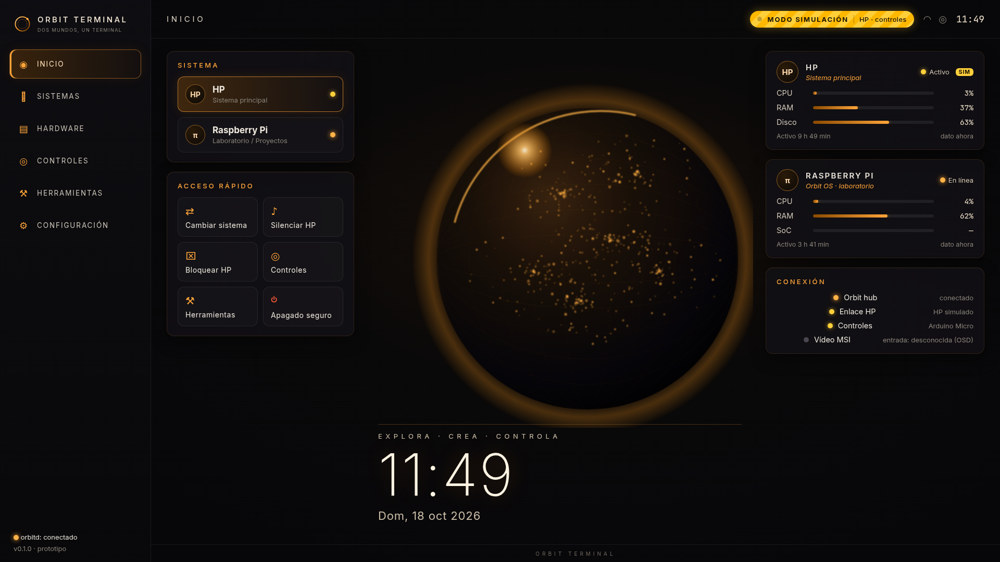

# Orbit Terminal

> **Repositorio `Sopa-IA/Control-deck` · producto *Orbit Terminal*.** El repositorio se llama *Control-deck*; el producto y el software se llaman *Orbit Terminal* / *Orbit OS*.

Orbit Terminal es un terminal de sobremesa en forma de cuña que reúne dos mundos en una sola pantalla: un **HP** reutilizado como sistema principal y una **Raspberry Pi** que ejecuta *Orbit OS*. Tiene consola de mandos física (potenciómetros y botones) y luces ámbar.

**Orbit OS 1.0.0** corre en la Raspberry Pi y en el HP (Windows 10 Home 22H2). El registro de cambios está en [`CHANGELOG.md`](CHANGELOG.md). La carcasa **no está lista para fabricar.**

> **Para retomar el proyecto sin contexto** (Miguel u otro agente): [`docs/ESTADO-Y-TRASPASO.md`](docs/ESTADO-Y-TRASPASO.md). Ahí están el mapa del repo, lo que Miguel ya tiene, cada STL con su caja medida, cómo llega la imagen del HP y los comandos para comprobar el CAD.
>
> **Manual de montaje** (prototipo, estilo IKEA, 21 páginas, dibujos del CAD): [`docs/manual-montaje/MANUAL_MONTAJE_ORBIT.pdf`](docs/manual-montaje/MANUAL_MONTAJE_ORBIT.pdf). No autoriza a fabricar. Lo que se imprime después de la base está en [`hardware/impresion/siguientes/README.md`](hardware/impresion/siguientes/README.md).



## Decisiones del prototipo

Detalle en [`docs/decisiones-prototipo.md`](docs/decisiones-prototipo.md).

- **Solo piezas que Miguel ya tiene.**
- **Pantalla:** MSI PRO MP161 E2U 15,6", 1920×1080, **no táctil**. Se usa con ratón y controles; la interfaz sigue preparada para táctil.
- **HP:** HP Slimline 260-a110ns **desmontado**; su placa mini-ITX va dentro de la cuña (adaptador externo de 19,5 V fuera, DVD retirado). El CAD usa el **HDD Toshiba 3,5"** real (`usar_hdd_35 = true`, cotas SFF-8301). El SSD 2,5" queda como opción del mismo parámetro.
- **Vídeo:** la MSI va solo a la Pi (micro-HDMI a mini-HDMI). La imagen del HP llega por un cable de red directo: el HP en `10.0.0.1` y la Pi en `10.0.0.2`, con Sunshine en el HP y Moonlight en la Pi. El teclado y el ratón son Bluetooth, emparejados con la Pi. La vista por defecto es integrada (barra de Orbit OS y Moonlight sin bordes en el hueco). La pantalla completa es la alternativa. Pasos en [`docs/instalacion-pi.md`](docs/instalacion-pi.md).
- **Controles:** potenciómetros y botones leídos por un **Arduino Nano** (clon ATmega328P, mini-USB). Sustituye al Micro: el Nano no tiene USB nativo y no puede hacer de teclado HID.
- **Placa de prácticas:** un segundo Nano, independiente, con pines y una OLED 0,96" en la trasera. Miguel tiene 4 OLED; Orbit usa una. El Uno de la foto no se monta. Se programa desde la sección **Ardu Lab**, sin el IDE. Detalle en [`docs/ardu-lab.md`](docs/ardu-lab.md).
- **ESP8266 NodeMCU** en su hueco de la bandeja, previsto para la tira LED con WLED. La tira sigue sin identificar.
- **Raspberry Pi 4** con HAT VHF (OLED y antena SMA). Medidas del HAT: pendientes. Si el HAT no deja pasar el GPIO, el conector de la Pi en el panel queda sin cablear.

## Estructura

```
README.md
docs/ESTADO-Y-TRASPASO.md    Estado para retomar el proyecto (léelo primero)
docs/manual-montaje/         Manual de montaje (PDF, 21 páginas, prototipo)
docs/                        Investigación fase 1, diseño mecánico, decisiones del prototipo
hardware/cad/                CAD paramétrico OpenSCAD, STL PROVISIONALES, scripts de comprobación
hardware/impresion/          Base, siguientes impresiones (STEP), plantillas mini-ITX y scripts
hardware/render/             Pipeline de los renders fotorrealistas
assets/renders/              Renders (v1 y láminas del prototipo)
assets/screenshots/          Capturas de la interfaz
software/interface/          Orbit OS Interface (React + TypeScript + Vite)
software/pi-controller/      orbitd: hub WebSocket, servidor de la interfaz y lector del Arduino (Python)
software/hp-agent/           Agente de telemetría y acciones de lista blanca para el HP (Python)
software/shared/             Protocolo v1: PROTOCOLO.md, esquema JSON, actions.json, tipos TS y paquete Python
software/arduino-controls/   Firmware del Nano de mandos (potenciómetros y botones)
software/arduino-pruebas/    Ejemplo del Nano de prácticas (monitor de pines en la OLED)
tests/python/                pytest (protocolo, orbitd, hp-agent, serie, vídeo)
scripts/                     Instalación, tests, simulación, capturas, token, compilación Arduino
.github/workflows/ci.yml     Lint + tests (ruff, pytest, tsc, vitest, build)
```

## Puesta en marcha (desarrollo)

Requisitos: Python ≥ 3.9 (probado con 3.13), Node.js 20 y npm. Opcionales: `arduino-cli` para el firmware y Chrome/Chromium para las capturas.

```bash
./scripts/setup-dev.sh              # crea .venv e instala los paquetes Python y las dependencias de la interfaz
. .venv/bin/activate
./scripts/test-all.sh               # ruff + pytest + tsc + vitest
./scripts/dev-sim.sh                # compila la interfaz y arranca orbitd simulado en http://127.0.0.1:8765/
```

Solo la interfaz, con el simulador del navegador: `cd software/interface && npm run dev` (http://localhost:5173).

### Con los equipos reales

1. **Token:** `./scripts/gen-token.sh` lo guarda en `.env` (ignorado por git). Hay que copiarlo al HP por un canal seguro.
2. **Raspberry Pi:** en la Pi, con Wi-Fi, `sudo bash scripts/instalar-pi.sh` y reinicia. El detalle, el emparejamiento y cómo salir del kiosco están en [`docs/instalacion-pi.md`](docs/instalacion-pi.md).
3. **HP (Windows 10):** en PowerShell como administrador, una línea. Hace falta internet en el HP; el cable `10.0.0.1` no lo da. ssh pide la contraseña de la Pi y no muestra el token. Guía: [`docs/instalacion-hp.md`](docs/instalacion-hp.md).

   ```powershell
   [Net.ServicePointManager]::SecurityProtocol = [Net.SecurityProtocolType]::Tls12; $u='https://raw.githubusercontent.com/Sopa-IA/Control-deck/cursor/bandeja-v2-modular-6d15/scripts/instalar-hp.ps1'; $p=Join-Path $env:TEMP 'instalar-hp.ps1'; Invoke-WebRequest -UseBasicParsing -Uri $u -OutFile $p; powershell -NoProfile -ExecutionPolicy Bypass -File $p
   ```

   Arranca en vivo: telemetría (CPU, memoria, disco, red en kb/s y temperatura), Bloquear, volumen, silencio, reproducir o pausar, Reiniciar y Apagar (60 s). La misma línea terminada en `-DryRun` deja solo la telemetría. La Pi tiene que actualizarse antes que el HP.
4. **Nano de mandos:** `./scripts/compile-arduino.sh` (también compila el ejemplo de prácticas) y luego `arduino-cli upload` con `arduino:avr:nano` o, en clones de bootloader viejo, `arduino:avr:nano:cpu=atmega328old`. Puerto de ejemplo `/dev/ttyUSB0`; si hay más de un USB-serie, `/dev/serial/by-id`. Ver [`software/arduino-controls/README.md`](software/arduino-controls/README.md) y [`software/arduino-pruebas/README.md`](software/arduino-pruebas/README.md).

Las capturas se regeneran con orbitd en marcha y `node scripts/screenshots.mjs` (usa `/usr/bin/google-chrome`, o la ruta que indique `CHROME_PATH`).

## Estado

| Componente | Estado | Notas |
|---|---|---|
| Protocolo v1: sobre JSON, esquema, autenticación por token, latido, lista blanca, apagado con confirmación | **Implementado** | Probado con pytest y vitest; ver [`software/shared/PROTOCOLO.md`](software/shared/PROTOCOLO.md) |
| orbitd: hub WebSocket, interfaz estática, lectura serie, mapeo de controles | **Implementado** | Probado en local (tests de integración con servidor real) |
| Telemetría de la Pi (psutil) | **Implementado** | Lee el equipo donde corre orbitd; si no es una Pi, lo indica |
| HP y controles en orbitd `--sim` | **Simulación** | Marcados con `simulated: true` y distintivo **MODO SIMULACIÓN** |
| Interfaz Orbit OS 1.0.0 (Inicio, Sistemas, Hardware, Controles, Ardu Lab, Herramientas, Configuración) | **En uso** | En la Pi. Lo que no tiene hardware se ve deshabilitado |
| hp-agent en el HP | **En uso** | Tarea `OrbitHpAgent`, en vivo. CPU, memoria, disco, red, temperatura, bloqueo, volumen, silencio, reproducir o pausar, apagado y reinicio a 60 s |
| Firmware del Nano de mandos | **En uso** | Conectado en la Pi. Los potenciómetros y los pulsadores no están cableados: la pantalla los deja apagados |
| Ejemplo OLED del Nano de prácticas | **Pendiente de validar** | `monitor_pines`: 5558 bytes, 18 % de la flash, los dos FQBN. Sin probar en placa ni en pantalla |
| ESP8266 y tira LED (WLED) | **Requiere intervención humana** | La tira sigue sin identificar. D6 del Nano de mandos ya no se reserva |
| Apagado de la Pi (`pi.shutdown`) | **Implementado** | Pide confirmación y, en la Pi, llama a systemctl. En el simulador no apaga |
| Tira de luz ámbar | **Falta conectarla** | Los botones están apagados. No se envía nada |
| Cambio de lo que se ve (`pi.switch_visible`, botón B2) | **En uso** | La MSI va solo a la Pi. La imagen del HP llega por el cable de red directo (HP `10.0.0.1`, Pi `10.0.0.2`): Sunshine en el HP y Moonlight en la Pi. Pasos en [`docs/instalacion-pi.md`](docs/instalacion-pi.md) |
| HP: **HP Slimline 260-a110ns** (A6-7310, 8 GB, HDMI + VGA, adaptador externo 19,5 V 65 W) | **Identificado y abierto** | **Medido por Miguel:** placa 17 × 17 cm, altura máxima 35 mm. Agujeros: patrón estándar mini-ITX (coincide visualmente con la foto, no medido). Sin escudo I/O. Faltan posición de conectores traseros, botón de encendido, antenas y BIOS: **requieren intervención humana** (`docs/datos-pendientes-hp.md` §A2, con nota de seguridad) |
| Pi 4 confirmada (2026-10-20) con HAT VHF; conexión a la MSI, medidas del HAT y si deja pasar el GPIO | **Requiere intervención humana** | El HAT no está modelado. Ver `software/arduino-pruebas/README.md` |
| Cifrado del enlace HP↔Pi (`wss://` / mTLS) | **Pendiente** | v0 usa `ws://` con token: solo en red de confianza o cable directo |
| Servicios systemd (Pi) y Chromium en kiosco | **En uso** | Sesión `orbit`. En el HP, la tarea `OrbitHpAgent` la crea `scripts/instalar-hp.ps1` |
| CAD (cuña 456,3 × 300,5 × 153,9 mm, 20 STL para Bambu Lab A1 en PLA+ negro mate) | **Pendiente de validar** | Disco vigente: **HDD 3,5"** (SFF-8301; la medición a ojo de ~150 × 100 × 25 mm no entra en el modelo). Separadores mini-ITX con agujero de inserto abierto por arriba; plantilla de agujeros **comprobada en la placa el 2026-10-19**. Base completa en impresión el 2026-10-20, sin resultado. Plantilla de pivotes (C 3,8 / F 3,6 / H 3,4 / J 3,2) **sin resultado**. STEP para SolidWorks en `hardware/impresion/`, sin regenerar el CAD. **NO apto para fabricación**. Detalle en [`docs/ESTADO-Y-TRASPASO.md`](docs/ESTADO-Y-TRASPASO.md) |
| Medidas de potenciómetros, pulsadores y puertos/teclas del MSI | **Requiere intervención humana** | Medir las piezas de Miguel y ajustar `params.scad`/`lib.scad` |

## Tests

Reejecutados el 2026-10-20 en este cambio (Nano, ESP y placa de prácticas):

- `ruff check software tests`: sin avisos.
- `pytest`: **50 pasados**.
- `vitest`: **27 pasados** en 6 archivos (Vitest 2.1.9).
- `tsc -b` y `vite build`: salida 0.
- `arduino-cli` 1.5.1, core `arduino:avr` 1.8.8: `orbit_controls` 2982 bytes (9 %) y `monitor_pines` 5558 bytes (18 %), cada uno en `arduino:avr:nano` y en `cpu=atmega328old`.
- `comprobar_interferencias.py`: sin interferencias, 19 cajas.
- `comprobar_stl.py`: las 20 caben y son mallas cerradas.

Esas cifras son del 2026-10-20. Después, Orbit OS, Moonlight, el Nano de mandos y hp-agent se probaron en la Pi y en el HP. La carcasa sigue sin estar lista para fabricar. El detalle de la 1.0.0 está en [`CHANGELOG.md`](CHANGELOG.md).

## Documentación

**Estado para retomar:** [`docs/ESTADO-Y-TRASPASO.md`](docs/ESTADO-Y-TRASPASO.md).

**Manual de montaje (prototipo, no listo para fabricar):** [`docs/manual-montaje/MANUAL_MONTAJE_ORBIT.pdf`](docs/manual-montaje/MANUAL_MONTAJE_ORBIT.pdf). Orden de impresión posterior a la base: [`hardware/impresion/siguientes/README.md`](hardware/impresion/siguientes/README.md).

**Fase 1:**
- [`docs/informe-fase1.md`](docs/informe-fase1.md)
- [`docs/pantallas.md`](docs/pantallas.md)
- [`docs/conmutacion-video-usb.md`](docs/conmutacion-video-usb.md)
- [`docs/controles.md`](docs/controles.md)
- [`docs/raspberry-pi.md`](docs/raspberry-pi.md)
- [`docs/alimentacion-preliminar.md`](docs/alimentacion-preliminar.md)
- [`docs/incertidumbres-hardware.md`](docs/incertidumbres-hardware.md)
- [`docs/datos-pendientes-hp.md`](docs/datos-pendientes-hp.md)

**Diseño y decisiones:**
- Decisiones del prototipo: [`docs/decisiones-prototipo.md`](docs/decisiones-prototipo.md) · Imagen del HP (Sunshine y Moonlight): [`docs/instalacion-pi.md`](docs/instalacion-pi.md) · HP y seguridad del desmontaje: [`docs/datos-pendientes-hp.md`](docs/datos-pendientes-hp.md)
- Diseño mecánico v1 + HP v3: [`docs/diseno-mecanico.md`](docs/diseno-mecanico.md) (CAD en `hardware/cad/`, renders en `assets/renders/`)

## Seguridad

- No se suben secretos. `.env`, `config.local.*`, `*.token`, `*.key` y `*.pem` están en `.gitignore`, y solo hay ejemplos (`.env.example`, `hp-agent.example.toml`).
- No se ejecuta texto arbitrario. Cada acción de la lista blanca se traduce a una orden fija.
- El software no diseña circuitos de red eléctrica. La batería queda como estudio futuro.

## Licencia

La que figura en el archivo `LICENSE` del repositorio (Apache-2.0, añadida por Miguel al crear `Sopa-IA/Control-deck`).
