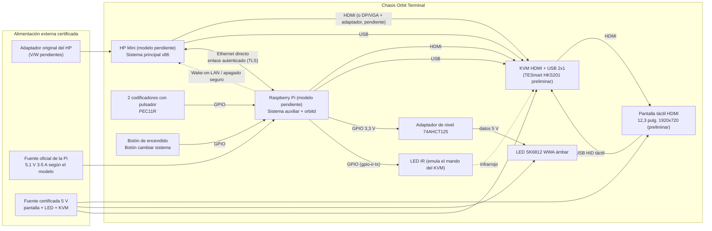

# ORBIT TERMINAL: informe de la Fase 1 (investigación y especificación preliminar)

> Documento: `docs/informe-fase1.md` · Fecha: **2026-10-18** · Estado: borrador para revisión del propietario (Miguel Rodríguez)
> Todos los datos proceden de fuentes enlazadas y comprobadas en esta fecha. Lo no verificado figura como **pendiente de verificar**. Este informe **no contiene resultados medidos**: todo es investigación documental y diseño preliminar.

> **Actualización HP v2 (2026-10-18), prevalece sobre este informe donde no coincida:**
> - **HP identificado: HP Slimline 260-a110ns** (AMD A6-7310, 8 GB DDR3L, HDMI + VGA, adaptador externo 65 W 19,5 V). Se **desmonta**: su placa mini-ITX va dentro de la cuña; DVD retirado, SSD 2,5" recomendado. → `datos-pendientes-hp.md` (fuentes y nota de seguridad)
> - **Vídeo:** sin KVM ni táctil. La MSI va solo a la Pi (micro-HDMI a mini-HDMI). La imagen del HP llega por un cable de red directo (HP 10.0.0.1, Pi 10.0.0.2), con Sunshine en el HP y Moonlight en la Pi. El teclado y el ratón son Bluetooth, emparejados con la Pi. Windows 10 Home no trae servidor RDP. → `instalacion-pi.md`
> - **Pantalla:** MSI PRO MP161 E2U (ver `decisiones-prototipo.md`). **CAD HP v2:** `diseno-mecanico.md`.

## 1. Resumen ejecutivo

Orbit Terminal combina **dos ordenadores que funcionan a la vez**: un HP reutilizado (sistema principal) y una Raspberry Pi (sistema auxiliar). Comparten **una pantalla táctil HDMI** mediante un **conmutador KVM HDMI + USB**. La Pi lee los dos mandos y los botones, controla la luz ámbar y el KVM, y se comunica con el HP por un **enlace Ethernet local autenticado**. Cambiar el "sistema visible" **no cambia de sistema operativo**: solo decide qué ordenador se ve y recibe el táctil.

Conclusiones principales:
1. **Pantalla:** recomendación preliminar **Waveshare 12.3inch 1920x720 LCD In-Cell (SKU 28481)**, a **109,99 USD** (waveshare.com) o **115,79 € sin IVA** (Kiwi Electronics). Funciona a 5 V con 5 W de máximo y su táctil USB no necesita controladores en Windows ni en Raspberry Pi OS. **Decisión pendiente de Miguel:** el formato barra (8:3) hace el equipo más bajo que el render. La alternativa con la proporción del render es la **Waveshare 11.6" (H) 1920×1080** (162,99 USD). → `pantallas.md`
2. **Conmutación:** viable con un KVM comercial, pero **sin garantía de compatibilidad con táctiles HID**: es el riesgo n.º 1 y se probará en el banco. Recomendación preliminar: **TESmart HKS201-P23-V2** (129,99 USD), por su emulación EDID y su mando IR, que la Pi puede emular. Como alternativa barata para el banco de pruebas, **UGREEN CM664** (196,17 PLN en ugreen.pl). → `conmutacion-video-usb.md`
3. **Controles:** codificadores **Bourns PEC11R-4220F-S0024** con el overlay del kernel `rotary-encoder` y LED **SK6812 WWA** (ámbar nativo de 1800–2000 K) con adaptador de nivel **74AHCT125**. → `controles.md`
4. **Raspberry Pi:** **usar la que Miguel ya tenga** (3B+, 4B o 5). Si hay que comprar, **Pi 5 de 2 GB (77,50 USD de precio máximo oficial)**. Zero 2 W descartada (sin Ethernet, 512 MB). → `raspberry-pi.md`
5. **Alimentación:** solo fuentes comerciales certificadas y ningún circuito de red propio. Batería solo como estudio futuro. El consumo del HP es la gran incógnita. → `alimentacion-preliminar.md`
6. **Software:** **interfaz web React + TypeScript** servida por un servicio local, en **Chromium en modo kiosco** en la Pi y en el navegador o una ventana dedicada en el HP. → §4
7. **Bloqueante principal:** el **modelo exacto del HP** ("HP Mini" puede ser un netbook con VGA o un Desktop Mini solo con DisplayPort). → `datos-pendientes-hp.md`, `incertidumbres-hardware.md`

## 2. Índice de documentos de la Fase 1

| Documento | Contenido |
|---|---|
| [`pantallas.md`](pantallas.md) | 6 pantallas HDMI táctiles reales con datos, precios y ranking |
| [`conmutacion-video-usb.md`](conmutacion-video-usb.md) | Viabilidad del KVM, control desde la Pi, EDID/hotplug, calibración, alternativas |
| [`controles.md`](controles.md) | Codificadores, pomos, GPIO, overlays, llegada de eventos al HP, LED ámbar |
| [`raspberry-pi.md`](raspberry-pi.md) | Comparativa de modelos de Pi, alimentación oficial y recomendación |
| [`incertidumbres-hardware.md`](incertidumbres-hardware.md) | Registro de incertidumbres con impacto y plan de cierre |
| [`datos-pendientes-hp.md`](datos-pendientes-hp.md) | Lista de datos que debe aportar Miguel y por qué |
| [`alimentacion-preliminar.md`](alimentacion-preliminar.md) | Distribución de alimentación y tabla de consumidores con fuentes |

## 3. Arquitectura preliminar de hardware

Notas:
- El **enlace HP↔Pi** es un cable Ethernet directo en una subred privada dedicada, con firewall y escucha solo en esa interfaz. Si Miguel quiere que la Pi o el HP tengan además salida a Internet, irá por otra interfaz (Wi-Fi), nunca exponiendo los controles.
- Todo el hardware entre paréntesis está **pendiente** de los datos del propietario.

## 4. Arquitectura de software preliminar

### 4.1 Componentes
| Componente | Dónde se ejecuta | Función |
|---|---|---|
| **Orbit OS Interface** | Pi (kiosco) y HP (navegador o ventana) | Interfaz táctil: estado de ambos sistemas, telemetría, accesos, configuración de mandos |
| **orbitd** | Pi (servicio systemd) | Lee los GPIO y `/dev/input` (codificadores, botones), controla LED y KVM, sirve la UI, coordina los apagados y mantiene el estado del sistema visible |
| **orbit-agent** | HP (servicio de Windows o systemd) | Telemetría del HP (CPU, RAM, disco, temperatura si el SO la expone), ejecuta **solo acciones de una lista blanca local**, apagado ordenado |
| **Protocolo Orbit Link** | Entre orbitd y orbit-agent | Mensajes JSON versionados sobre WebSocket con TLS mutuo (certificados propios generados en la instalación, sin credenciales en el repositorio); latido periódico para detectar desconexiones; identificador único y caducidad en cada orden para evitar repeticiones |
| **Modo simulación** | Cualquier PC | Hardware simulado (codificadores, KVM, LED y telemetría falsa) para desarrollar y probar sin componentes físicos |

### 4.2 Evaluación de opciones para la interfaz

| Criterio | **React + TypeScript (web)** | Tauri v2 | Electron | Qt / QML | Flutter |
|---|---|---|---|---|---|
| Mismo código en la Pi (Linux ARM64) y en el HP (Windows/Linux x86) | Sí, cualquier navegador moderno | Sí, pero usa WebKitGTK 4.1 en Linux; hay incidencias abiertas de compatibilidad en Linux¹ | Sí, publica binarios para Linux ARM64 y x86 | Sí | Sí (escritorio) + `flutter-pi` en la Pi sin X11² |
| Coste en RAM/CPU en la Pi | Medio (Chromium en kiosco) | Bajo/medio (WebView del sistema) | **Alto** (Chromium empaquetado por app) | **Bajo** (nativo, renderizado por GPU) | Bajo |
| Kiosco documentado en la Pi | **Sí, tutorial oficial** (Chromium + labwc)³ | No oficial | No oficial | eglfs, sin escritorio | flutter-pi |
| Pruebas automatizadas y CI | Muy maduras (Vitest, Playwright) y ejecutables en CI sin hardware | Igual que web + Rust | Igual que web | Qt Test; CI más compleja | `flutter test` |
| Simulación en cualquier PC | **Inmediata** (abrir en el navegador) | Requiere compilar | Requiere compilar | Requiere compilar | Requiere compilar |
| Licencia / control de la PI | MIT (React), Apache-2.0/MIT (Tauri) | MIT/Apache-2.0 | MIT | Comercial o GPL/LGPLv3⁴ (obligaciones a revisar) | BSD-3 |
| Curva y velocidad de iteración | **Alta velocidad** | Media (Rust) | Alta | Baja (C++/QML) | Media (Dart) |

¹ https://v2.tauri.app/start/prerequisites/ · https://github.com/tauri-apps/tauri/issues/9039
² https://github.com/ardera/flutter-pi (probado por su autor en una Pi 4 de 2 GB; funciona en Pi 2/3/4 y Zero 2 W)
³ https://www.raspberrypi.com/tutorials/how-to-use-a-raspberry-pi-in-kiosk-mode/
⁴ https://www.qt.io/licensing/

### 4.3 Recomendación
**React + TypeScript (Vite) como interfaz web, servida por `orbitd` y mostrada en Chromium en modo kiosco en la Pi**, con el método oficial de autostart de labwc. Motivos:
1. **Una sola base de código** para la Pi y el HP, sin compilar por plataforma.
2. **El modo simulación sale gratis:** la misma UI se abre en cualquier navegador con un backend simulado, cumpliendo la regla de "desarrollar sin esperar al hardware".
3. **Pruebas y CI baratas** (pruebas unitarias y E2E con Playwright, sin hardware ni emuladores).
4. Evita las ataduras de licencia de Qt y el coste en RAM de Electron.
5. **Salida futura:** si en el HP se necesita una ventana nativa sin barras, o integración con el SO, la misma UI se puede envolver en **Tauri** sin reescribirla.

**Backend (`orbitd` y `orbit-agent`): Python 3** (gpiozero, python-evdev, psutil y un servidor ASGI con WebSocket). Es el lenguaje con mejor soporte de GPIO en Raspberry Pi OS (gpiozero viene preinstalado) y funciona en Windows y Linux para el agente. Las librerías concretas se justificarán en el repositorio al añadirlas.

**Riesgo a medir en la Fase 2:** el uso de RAM y CPU de Chromium en modo kiosco en una Pi 3B+ de 1 GB. Si fuera insuficiente, se pasaría a Qt/QML o Flutter, solo para la UI de la Pi.

## 5. Presupuesto preliminar (solo precios con fuente)

> Precios de catálogo en la fecha indicada, **sin envío, aranceles ni IVA** salvo indicación. Monedas originales sin convertir. **El agente no realiza compras**: es una estimación para la decisión del propietario.

| Partida | Elección preliminar | Cant. | Precio unitario | Fuente (2026-10-18) |
|---|---|---|---|---|
| Pantalla táctil | Waveshare 12.3" In-Cell (28481) | 1 | 109,99 USD · 115,79 € sin IVA | waveshare.com · kiwi-electronics.com |
| KVM HDMI + USB | TESmart HKS201-P23-V2 | 1 | 129,99 USD | tesmart.com |
| *(alternativa KVM)* | UGREEN CM664 | 1 | 196,17 PLN con IVA | ugreen.pl |
| *(alternativa KVM)* | ATEN CS692 | 1 | 78,66 € con IVA | lifeinformatica.com |
| Raspberry Pi | Pi 5 de 2 GB (**solo si Miguel no tiene ninguna**) | 0–1 | 77,50 USD (máx. oficial) | raspberrypi.com/news (1-oct-2026) |
| Codificadores | Bourns PEC11R-4220F-S0024 | 2 | 1,89 USD | Mouser (según el buscador) |
| Adaptador de nivel | 74AHCT125 (Adafruit 1787) | 1 | 1,50 USD (agotado) | adafruit.com |
| Microcontrolador HID (opcional, respaldo) | Raspberry Pi Pico | 0–1 | desde 4 USD | raspberrypi.com |
| Tira LED | SK6812 WWA | — | **pendiente** | — |
| Pomos | Aluminio para eje de 6 mm + difusor | 2 | **pendiente** | — |
| Fuentes (Pi, 5 V auxiliar) | Oficial de la Pi + 5 V certificada | — | **pendiente** | — |
| Carcasa (filamento, aluminio, tornillería) | — | — | **pendiente** (Fase 4) | — |
| HP | Reutilizado | 1 | 0 (hardware existente) | — |

**Subtotal parcial del escenario recomendado con precios conocidos en USD** (pantalla + TESmart + Pi 5 2 GB + 2 codificadores + 74AHCT125): **322,76 USD** sin envío ni impuestos. Si Miguel ya tiene una Pi, se restan 77,50 USD. **No es el coste total**: faltan las partidas pendientes, y los precios en euros con IVA para España están pendientes de verificar (U-17).

## 6. Hoja de ruta priorizada (Fases 1–5)

| Fase | Objetivo | Entregables | Criterios de aceptación |
|---|---|---|---|
| **1. Investigación y especificación** (en curso) | Base documental y decisiones preliminares | Estos 8 documentos; repositorio privado `Sopa-IA/orbit-terminal` inicializado | (a) Documentos en el repositorio con fuentes y fechas; (b) Miguel ha respondido a `datos-pendientes-hp.md` (al menos U-01, U-02, U-06, U-10); (c) pantalla y KVM elegidos por Miguel. **No se considera completa hasta cumplir (b) y (c).** |
| **2. Software en simulación** | Orbit OS Interface + orbitd + orbit-agent + protocolo, con hardware simulado | UI React/TS en kiosco simulado, servicio con controladores simulados (codificadores, KVM, LED), protocolo autenticado, CI mínima | (a) Se ejecuta con un solo comando en un PC sin hardware; (b) pruebas unitarias y E2E en verde en CI; (c) pruebas que **rechazan** conexiones sin certificado válido y órdenes fuera de la lista blanca; (d) detección de desconexión probada; (e) documentación de uso. |
| **3. Banco de pruebas eléctrico** | Validar con hardware real fuera de la carcasa | Montaje en mesa: HP + Pi + KVM + pantalla + mandos + LED; informes de medición | (a) Táctil funcional en ambos sistemas a través del KVM (U-03); (b) 100 conmutaciones seguidas controladas por la Pi sin fallos; (c) tiempos de conmutación y consumos **medidos** y registrados; (d) eventos de los mandos aplicados en el HP por red; (e) apagado seguro de ambos sistemas verificado. |
| **4. Diseño industrial y CAD paramétrico** | Carcasa fiel al concepto y fabricable en casa | Modelo paramétrico (herramienta a elegir: FreeCAD, CadQuery u OpenSCAD) con dimensiones reales, planos, piezas imprimibles y estudio térmico | (a) Todas las cotas críticas vienen de datos medidos o planos del fabricante; (b) prueba de encaje impresa de cada componente; (c) temperaturas medidas en carga, con la carcasa cerrada, dentro de los límites de los fabricantes; (d) piezas dentro del volumen de impresión disponible (D-8.4). |
| **5. Integración, documentación y pruebas finales** | Dispositivo montado y documentado | Prototipo integrado, manual de montaje, BOM con costes fechados, pruebas documentadas | (a) Montaje reproducible siguiendo solo el manual; (b) lista de pruebas de aceptación superada y documentada; (c) BOM con fuente y fecha en cada precio; (d) resultados medidos claramente separados de las simulaciones. |

### Próximas acciones inmediatas (prioridad)
1. **Miguel:** crear el repositorio privado `Sopa-IA/orbit-terminal` (bloqueo actual) y responder a `datos-pendientes-hp.md` (fotos de la etiqueta y los puertos del HP, adaptador y modelo de Pi).
2. **Agente:** Fase 2 en paralelo, porque no depende del hardware: estructura del repositorio, UI en simulación, orbitd y orbit-agent simulados, protocolo y CI mínima.
3. **Miguel:** decidir el formato de pantalla (barra 12,3" o 11,6" 16:9).
4. **Agente:** cuando llegue el modelo del HP, buscar sus QuickSpecs oficiales y cerrar U-01, U-02, U-07 y U-08.
5. **Agente:** preparar la lista de compra mínima del banco de pruebas (sin comprar) para que Miguel la apruebe.

## 7. Preguntas clave para Miguel
1. ¿Qué es exactamente tu HP? Foto de la etiqueta (modelo y P/N) y de todos sus puertos.
2. ¿Qué Raspberry Pi tienes (modelo y RAM) y con qué fuente?
3. Pantalla: ¿barra 12,3" 1920×720 (más baja que el render) o 11,6" 1920×1080 (proporciones del render)?
4. ¿Tienes ya alguna pantalla táctil, KVM, codificadores, tiras LED o fuentes que podamos reutilizar?
5. ¿Tienes impresora 3D (modelo y volumen) o acceso a mecanizado de aluminio?
6. ¿Qué sistema operativo lleva el HP y puedo cambiarlo? ¿Tiene Wake-on-LAN en la BIOS?
7. ¿Hay un presupuesto máximo orientativo para las compras del prototipo?
