# Orbit Terminal — manual de montaje

Un subpaso, una acción, una figura. La pieza que se añade va en naranja y lo ya montado en gris. El número marca el agujero. La silueta del tornillo, a escala 1:1, está en el PDF.

Lo que sale de cada kit está contado contra el bote, **sin repuesto**. No se ha apretado en el plástico, salvo el M3 de los pasadores: con ese Miguel ya cerró la carcasa. El ×16 de ese tornillo llena el agujero y no es una medida del tornillo que él usó.

Fecha del CAD: 2026-10-23. No es un montaje probado. La carcasa impresa no se corta. Los STL FUTURO_ no se imprimen ahora.

## Qué sale de cada kit

Fuente del inventario: [inventario-taller](https://github.com/Sopa-IA/inventario-taller), archivo `tornilleria/inventario.csv`. Este manual no escribe en ese repo. Las reservas van en `consumo.md`, cuando Miguel las apunte con estas cuentas.

El CSV no se ha podido leer desde aquí (el acceso al repo privado devolvió 404). Las existencias de la tabla son las de los tres kits, tal como están en el encargo. Conviene contrastarlas con el CSV al escribir `consumo.md`.

JINZEYOU 840: cabeza de botón ISO 7380, acero negro, Allen. El largo es **bajo la cabeza**.

wugongshan 860: avellanado Phillips. El largo **incluye la cabeza**.

Insertos de latón 360. La cota es largo × Ø exterior. El agujero Ø4,0 (M3, OD 5) y el Ø3,0 (M2.5, OD 3,5) son fallback, sin ficha del fabricante y sin probar.

| Pieza | En el aparato | En el kit | Para qué | Estado |
|---|---:|---:|---|---|
| M3×16 cabeza de botón, Allen 2 mm, JINZEYOU 840 | 17 | 20 | 9 pasadores (ya puestos) y 8 pletinas | Del kit. Sin probar, salvo el M3 con el que ya se cerró la carcasa. |
| Tuerca M3, del kit JINZEYOU | 8 | 100 | 8 pletinas, por debajo | Del kit. Sin probar. |
| M3×8 avellanado negro, Phillips, wugongshan 860 | 29 | 40 | 13 orejetas, 4 del disco y 12 del bisel | Del kit. El largo incluye la cabeza. Sin probar. |
| M3×6 avellanado negro, Phillips, wugongshan 860 | 4 | 40 | 4 de la placa HP | Del kit. Sin probar. En la placa HP la cabeza apoya en la PCB. Los adaptadores no llevan tornillo. |
| M3×8 cabeza de botón, Allen 2 mm, JINZEYOU 840 | 10 | 30 | 4 del step-down, 4 de la bandeja a la base y 2 de la tapa | Del kit. Largo bajo la cabeza. Sin probar. |
| M3×12 cabeza de botón, Allen 2 mm, JINZEYOU 840 | 14 | 30 | 12 grapas de ESP y Nanos, y 2 pomos | Del kit. Largo bajo la cabeza. Sin probar. |
| M2.5×8 cabeza de botón, Allen 1,5 mm, JINZEYOU 840 | 4 | 40 | Los cuatro agujeros reales de la Pi | Del kit. Largo bajo la cabeza. Sin probar. |
| Inserto de latón M3, 5×5 mm (largo × Ø exterior) | 26 | 30 | 10 orejetas, 12 postes del bisel y 4 del soporte del disco | Kit de latón 360. Agujero Ø4,0, sin ficha y sin probar. |
| Inserto de latón M3, 4×5 mm | 6 | 30 | 4 separadores HP y 2 pomos | Kit de latón 360. Agujero Ø4,0, sin probar. El 5×5 no cabe en el separador. Los adaptadores no llevan inserto. |
| Inserto de latón M3, 6×5 mm | 4 | 30 | 4 torretas de la bandeja | Kit de latón 360. Agujero Ø4,0, sin probar. |
| Inserto de latón M2.5, 4×3,5 mm | 4 | 40 | 4 postes de la Pi | Kit de latón 360. Agujero Ø3,0, sin ficha y sin probar. |

| FALTA: comprar | Cantidad | En el kit | Para qué | Estado |
|---|---:|---:|---|---|
| 6-32 UNC × 1/4" (6,4 mm), Phillips PH2 | 4 | 0 | Disco Toshiba de 3,5", por debajo | No lo trae ningún kit. Valen los tornillos originales de la torre, si siguen ahí. |
| Regleta macho 2×20, paso 2,54 mm, pines ≥ 11 mm | 1 | 0 | GPIO de la Pi, por los Ø1,6 de abajo | FALTA: comprar. El CSV de electrónica no se ha podido leer. |
| Regleta macho 2×12, paso 2,54 mm, pines ≥ 11 mm | 1 | 0 | Nano de prácticas, por los Ø1,6 de arriba. No es 2×15 | FALTA: comprar. |
| Cables Dupont hembra-hembra, paso 2,54 mm | los que hagan falta | 0 | Del panel de pines (fuera) a la Pi y al Nano | FALTA: comprar. En el panel el extremo puede ser recto. |
| Dupont hembra acodado a 90°, paso 2,54 mm | uno por pin | 0 | Las tres placas de la bandeja, pines hacia abajo | FALTA: comprar. El recto (carcasa ~14,5 mm) no entra en los 13 mm. Nano: 30 por placa. ESP: cuéntalos en la placa. |
| Step-down LM2596, 43 × 21 mm, a 5 V | 1 | 0 | Hueco (399, 124) de la bandeja | FALTA: comprar. No está en el inventario. Ahí hay ahora un convertidor ZERO/SPAN de 4–20 mA. |

El plan B del botón, si la cola no aguanta, son 2× M2×3 de cabeza plana (wugongshan, plata). No entran en la cuenta. El bote trae 50.

Para `consumo.md`, en el repo del inventario (aquí no está ese archivo): el M3×6 avellanado sigue en 4 y el inserto M3 de 4×5 sigue en 6. Los adaptadores no gastan tornillo. La bandeja v3 usa los mismos M3×12, M3×8 y grapas: no reserva tornillo nuevo. Anota como compra las dos regletas macho, los Dupont hembra-hembra del panel, los Dupont hembra acodados a 90° de la bandeja (30 por cada Nano; los del ESP, al contarlos) y un step-down LM2596 de 43 × 21 mm a 5 V.

Quedan sin usar, entre otros: el resto de M2, M2.5 y M4–M6, los insertos 1/4-20, y los avellanados M3×4 y M3×5. No se reservan.

Herramienta: Allen de 2 mm (M3 de botón), Allen de 1,5 mm (M2.5 de botón), Phillips del kit wugongshan, Phillips PH2 para los 6-32, soldador para los insertos, broca de Ø4,0 mm, broca de Ø3,0 mm y broca de Ø2,5 mm. El plan B del botón pide además una broca de Ø1,6 mm.

## Adaptar lo ya impreso

No se reimprime la base, ni las cuatro carcasas (las cuatro ya están impresas), ni el botón de prueba, ni los carros. `carcasa_x0_y1` y `carcasa_x1_y1` no se cortan: el marco, la tapa y la careta entran en los huecos que ya hay. Los STL `FUTURO_carcasa_*_sin_adaptadores` no se imprimen ahora. El inserto de la orejeta va en la orejeta. No abras el suelo a Ø4.

| Pieza | Qué hacer | Broca | Tornillo o inserto |
|---|---|---|---|
| Pasadores, 9 | Si ya está cerrada, salta el paso 2. Esos nueve M3×16 se cuentan como gastados. | Nada | M3×16 botón |
| Pletinas, 8 | Tornillo desde arriba, tuerca debajo. | Nada | M3×16 botón + tuerca M3 |
| Diez orejetas ya impresas | Inserto en el agujero Ø4 × 5,7 de la orejeta. El suelo se queda en Ø3,4, que ya deja pasar un M3. | Nada. Si el Ø4 se abrió a Ø4,6, el inserto no agarra. | M3 5×5 y M3×8 avellanado |
| Tres orejetas de x1_y1 | No toques el STL. Guía Ø2,5 × 9 mm. | Nada | M3×8 avellanado, sin inserto |
| Soporte del disco | El agujero ya es Ø4. El STL no cambia. Duda de si ya está impreso. | Nada | M3 5×5 y M3×8 avellanado |
| Separadores HP | Agujero Ø4 × 6,2 en la base impresa. Un 6×5 no cabe. | Nada | M3 4×5 y M3×6 avellanado |
| Bisel, 12 | El inserto va en el poste de la carcasa. El bisel ya tiene paso y avellanado. | No abras a Ø4,6 | M3 5×5 y M3×8 avellanado |
| Torretas de la bandeja, 4 | Abre el techo macizo a Ø4,0. Si ya está a Ø3,4, ábrelo a Ø4,0. | Ø4,0 | M3 6×5 y M3×8 botón. No otro M3×16 |
| Bandeja v2 ya impresa | No la cortes ni la taladres. Las cuatro paredes cierran los pines. Imprime la v3. | Nada | Los mismos M3×12 y grapas, en la v3 |
| Bandeja v3, Pi | El STL nuevo ya trae el Ø3,0 × 7 mm. No hace falta broca. | Nada | M2.5 4×3,5 y M2.5×8 botón |
| Pomos | Si el impreso solo tiene el radial Ø2,5, reimprime. | Nada | M3 4×5 y M3×12 botón |
| Tapa de la Pi | Imprime el STL nuevo. La de 94 × 54 no se usa. Los postes de x1_y1 siguen. | Nada en la carcasa | M3×8 botón |
| Disco Toshiba | La rosca del disco es 6-32. | Nada | FALTA: 4× 6-32 UNC × 1/4" |
| Ventana frontal, x0_y1 | Se queda en 62 × 18. El marco entra a presión. Se pierden los dos jacks frontales. | Nada | Sin tornillo. |
| Agujeros viejos, x1_y1 | No son la Pi. La tapa entra por dentro, un tetón por hueco. | Nada | Sin tornillo. La Pi se alcanza por la tapa del techo. |
| Panel de pines, x1_y1 | Los Ø1,6 se quedan. La careta va por fuera, con ganchos en OLED y PRG. | Nada | FALTA: regleta macho 2×20, regleta macho 2×12 y cables Dupont hembra-hembra. |

Los capuchones de punta que ya cubren un M3 siguen valiendo en las pletinas: el tornillo sigue siendo M3 y asoman unos 4 mm bajo la tuerca. Los cuatro de la bandeja no salen por debajo de la base.

## Para el botón de encendido

No son tornillos del kit. La carcasa no se taladra.

| Pieza | Compras | Nota |
|---|---:|---|
| Pulsador táctil 12×12×7,3 mm, 4 patillas, unos 100 gf | 1 | De catálogo. El recorrido del clic es 0,25 mm. Si el tuyo es de 6×6, cambia sw_tipo y reexporta solo el soporte. |
| LED de 3 mm (T-1), cualquier color | 1 | La brida no pasa el Ø3,1. La luz sale por la guía. El cuerpo es Ø3,0. |
| Resistencia 1 kΩ, 1/4 W | 1 | Solo si el cabezal del HP no limita ya el LED. No la pongas hasta medirlo. |
| Cable fino, 30 cm | 4 | Dos del pulsador y dos del LED. El largo es de diseño: el recorrido real no está medido. |
| Cianoacrilato | 1 | El soporte se pega a la cara interior. No taladres la carcasa. |

## Piezas

| Pieza | STL | Qué hacer |
|---|---|---|
| Prueba del botón | PRUEBA_boton | Imprimir hoy, plana, sin soportes. No se monta. |
| Capuchón de encendido | PROVISIONAL_boton_encendido | Imprimir hoy. Pestaña abajo, símbolo arriba. Sin soportes. |
| Soporte del botón | PROVISIONAL_soporte_boton | Imprimir hoy. Suelo abajo, placa de canto. Sin soportes. Se pega por dentro. |
| Base, 4 trozos | PROVISIONAL_base_x0_y0 … x1_y1 | Ya impresa. No reimprimir. Plana, sin soportes. |
| Carcasas izquierda y delantera derecha | PROVISIONAL_carcasa_x0_y0, x0_y1, x1_y0 | Ya impresas. No reimprimir. |
| Carcasa trasera derecha | PROVISIONAL_carcasa_x1_y1 | Ya impresa. No reimprimir y no cortar. |
| Pletinas ×4 | PROVISIONAL_pletina_empalme_x4 | Imprimir planas, sin soportes. |
| Soporte de disco 3,5" | PROVISIONAL_soporte_disco | Imprimir con el plato abajo. |
| Bandeja v3 | PROVISIONAL_bandeja_servicio | Pieza de noche. Ala abajo. Ventanas de 13 mm en los cantos largos. La ya impresa no se usa: está en OBSOLETA_bandeja_huecos_v2_ya_impresa. |
| Grapas de esquina ×16 | PROVISIONAL_grapa_esquina | Pieza de día. Plana, sin soportes. 14 en el aparato y 2 de más, por si una se parte. No es tornillo del kit. |
| Placa I/O | PROVISIONAL_placa_io_hp | Pieza de día. Pestaña abajo. Huecos de la foto del 2026-10-23. Entra por dentro. |
| Marco de prueba de la placa | PRUEBA_placa_io_hp | Pieza de día. Plana. Se sujeta por fuera antes de montar la placa. No se pega. |
| Marco del I/O frontal | PROVISIONAL_marco_io_frontal | Pieza de día. Cara de fuera abajo. Entra a presión en la ventana de 62 × 18. No se corta la carcasa. |
| Tapa de agujeros viejos | PROVISIONAL_placa_puertos_pi | Pieza de día. Reborde abajo. Tapa, por dentro, los agujeros que no son la Pi. |
| Careta de pines | PROVISIONAL_panel_pines | Pieza de día. Rótulos abajo, ganchos arriba. Cubre el campo de Ø1,6 por fuera. |
| Carcasa futura, izquierda trasera | FUTURO_carcasa_x0_y1_sin_adaptadores | No imprimir ahora. Hueco frontal de 94 × 18, sin marco. Pieza de noche si algún día se imprime. |
| Carcasa futura, derecha trasera | FUTURO_carcasa_x1_y1_sin_adaptadores | No imprimir ahora. Ranuras de cable de la Pi y de las regletas, sin careta. Pieza de noche si algún día se imprime. |
| Tapa de la Pi | PROVISIONAL_tapa_pi | Imprimir plana, chaflán abajo. La ya impresa no vale. |
| Biseles ×4 | PROVISIONAL_bisel_x0_y0 … x1_y1 | Si ya están impresos, no reimprimir. El agujero ya es paso M3 con avellanado. No se taladran. |
| Guías ×2 | PROVISIONAL_guia_luz_frontal_0 y _1 | Imprimir boca abajo, PETG translúcido. |
| Anillos ×2 | PROVISIONAL_anillo_luz_x2 | Imprimir como salen, PETG translúcido. |
| Pomos ×2 | PROVISIONAL_pomo_x2 | Pieza de día. Tapa abajo. Llevan el bolsillo del inserto. Si el viejo solo tiene Ø2,5 radial, no sirve. |
| Carros, retenedor, soporte de Arduino | sus STL provisionales | No imprimir y no montar. |

## Paso 1. Une la base

Las cuatro piezas ya están impresas. Torretas hacia arriba. No las reimprimas.

### 1.1 Coloca las cuatro piezas

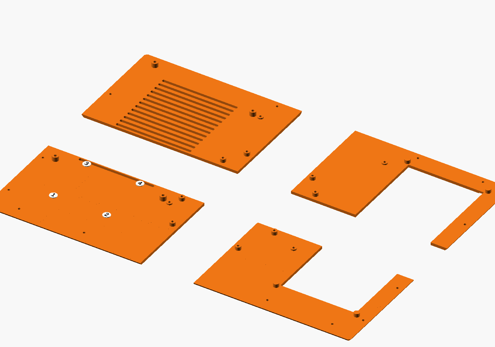

**NECESITAS:** Nada. Este paso no lleva tornillo.

Pon las cuatro piezas en cruz, con las torretas hacia arriba. Aún no las atornilles.

### 1.2 Pletina delantera

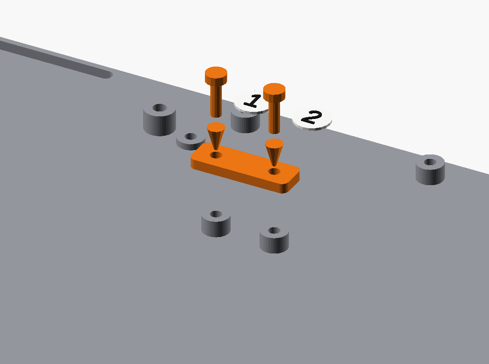

**NECESITAS:** 2× M3×16 cabeza de botón, Allen 2 mm, JINZEYOU 840  ·  2× Tuerca M3, del kit JINZEYOU

Pon la pletina sobre las dos torretas del cruce delantero. M3×16 de cabeza de botón desde arriba. Tuerca M3 debajo. Aprieta hasta que no se mueva. La pila mide 12 mm: salen unos 4 mm para la tuerca.

### 1.3 Pletina trasera del mismo corte

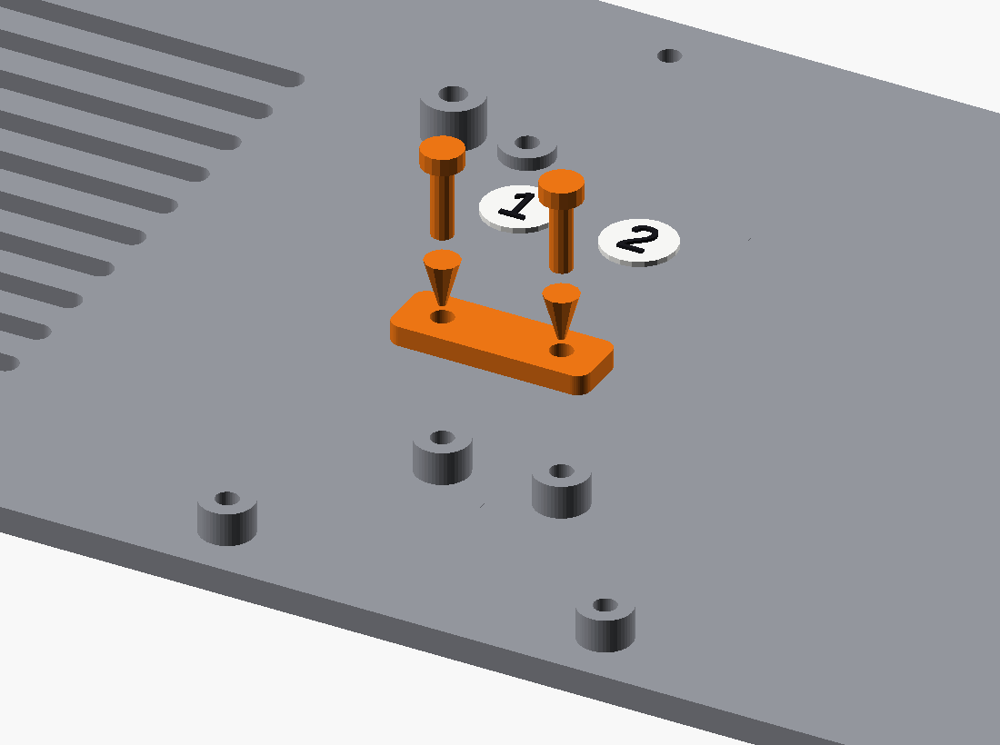

**NECESITAS:** 2× M3×16 cabeza de botón, Allen 2 mm, JINZEYOU 840  ·  2× Tuerca M3, del kit JINZEYOU

Haz lo mismo en el cruce de atrás. M3×16 de cabeza de botón desde arriba. Tuerca M3 debajo.

### 1.4 Pletina izquierda

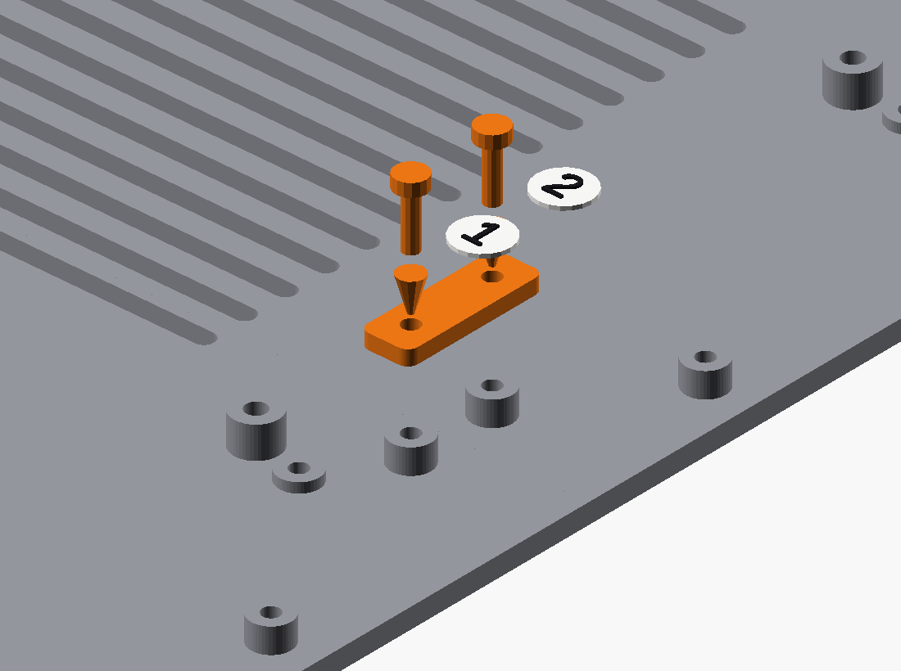

**NECESITAS:** 2× M3×16 cabeza de botón, Allen 2 mm, JINZEYOU 840  ·  2× Tuerca M3, del kit JINZEYOU

Pon la pletina del corte largo, en el lado izquierdo. M3×16 de cabeza de botón desde arriba. Tuerca M3 debajo.

### 1.5 Pletina derecha

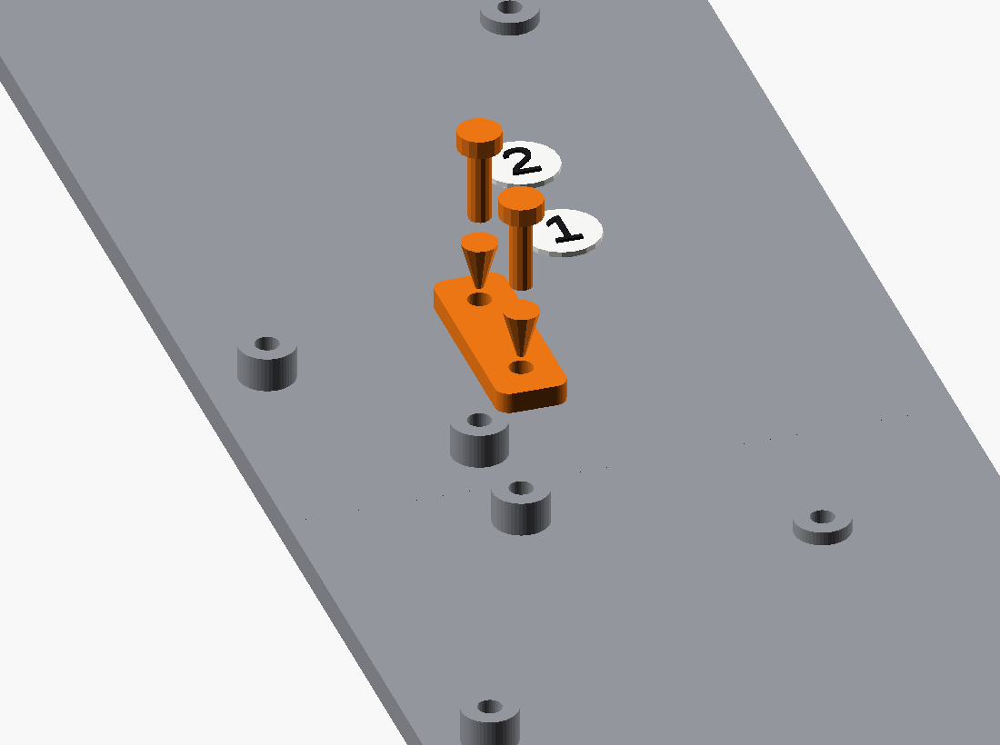

**NECESITAS:** 2× M3×16 cabeza de botón, Allen 2 mm, JINZEYOU 840  ·  2× Tuerca M3, del kit JINZEYOU

Cierra el último cruce, a la derecha. M3×16 de cabeza de botón desde arriba. Tuerca M3 debajo.

De los kits, en este paso: 8× M3×16 cabeza de botón, Allen 2 mm, JINZEYOU 840, 8× Tuerca M3, del kit JINZEYOU.

## Paso 2. Une la carcasa

Si la carcasa ya está unida con M3, salta al paso 3.1.

### 2.1 Par izquierdo

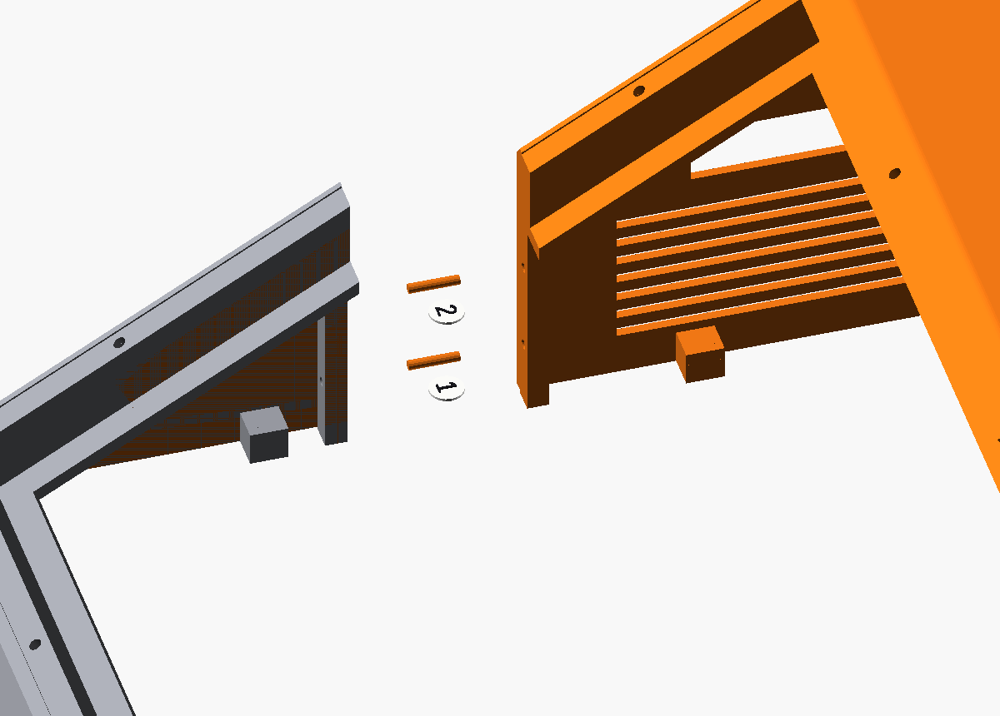

**NECESITAS:** 2× M3×16 cabeza de botón, Allen 2 mm, JINZEYOU 840

Junta las dos piezas de la izquierda. Mete un M3×16 de cabeza de botón en cada agujero del corte. Aprieta hasta que las caras se toquen.

### 2.2 Par derecho

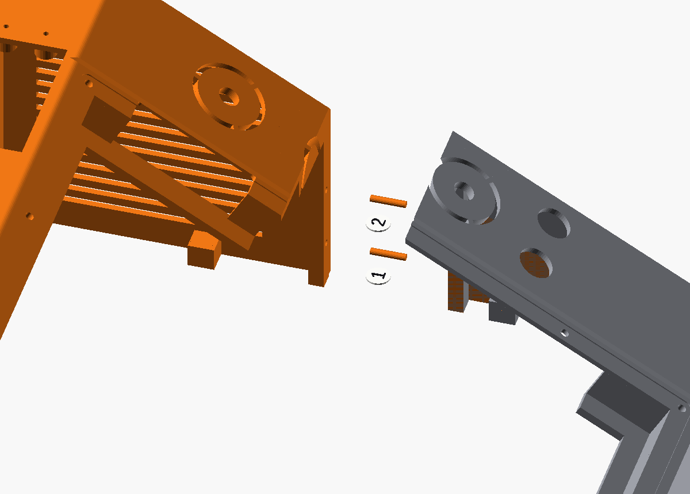

**NECESITAS:** 2× M3×16 cabeza de botón, Allen 2 mm, JINZEYOU 840

Junta las dos piezas de la derecha. Dos M3×16 de cabeza de botón, igual que antes.

### 2.3 Las dos piezas de atrás

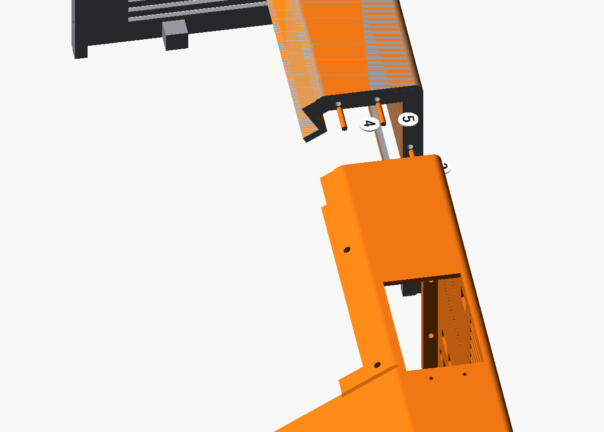

**NECESITAS:** 5× M3×16 cabeza de botón, Allen 2 mm, JINZEYOU 840

Junta las dos piezas traseras. Cinco M3×16 de cabeza de botón en los cinco agujeros del corte. Aprieta en cruz. Estos nueve, con los ocho de las pletinas, dejan tres M3×16 en el bote.

De los kits, en este paso: 9× M3×16 cabeza de botón, Allen 2 mm, JINZEYOU 840.

## Paso 3. Carcasa sobre la base

El tornillo de la orejeta entra siempre desde abajo. El inserto va en la orejeta, no en el suelo: el suelo solo tiene 4 mm y un inserto de 5 mm no cabe ahí.

### 3.1 Diez insertos en las orejetas ya impresas

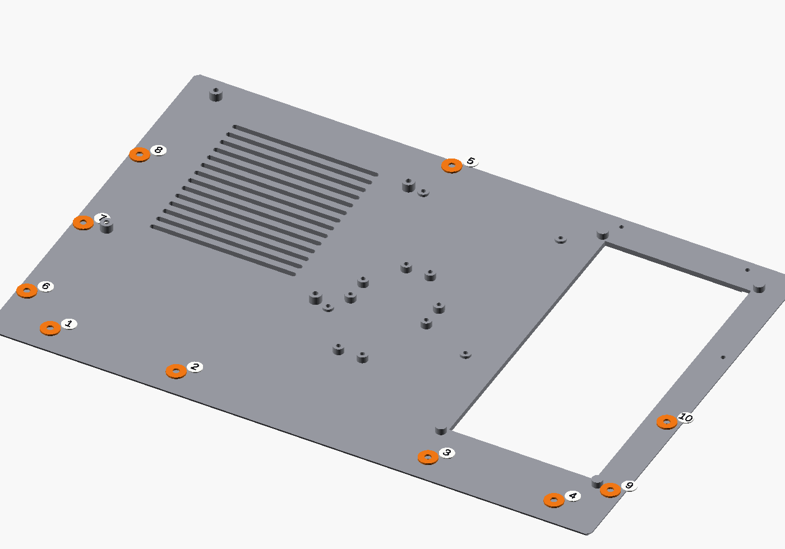

**NECESITAS:** 10× Inserto de latón M3, 5×5 mm (largo × Ø exterior)

Con el soldador, mete un inserto M3 de 5×5 en el agujero Ø4 de cada una de las diez orejetas viejas. Entra desde abajo, a ras de la cara que apoya en la base. El agujero mide unos 5,7 mm: el de 5 mm cabe y el de 6 mm no. No abras el Ø3,4 de la base.

**PENDIENTE DE MEDIR.** El Ø4,0 es el fallback para un inserto de Ø exterior 5. No hay ficha y no se ha probado. Si esa orejeta ya se abrió a Ø4,6, el inserto no agarra: pasa un M3 y pon tuerca arriba. En las cuatro columnas del frente la tuerca no tiene sitio: esas tienen que quedar con el inserto.

### 3.2 Baja la carcasa

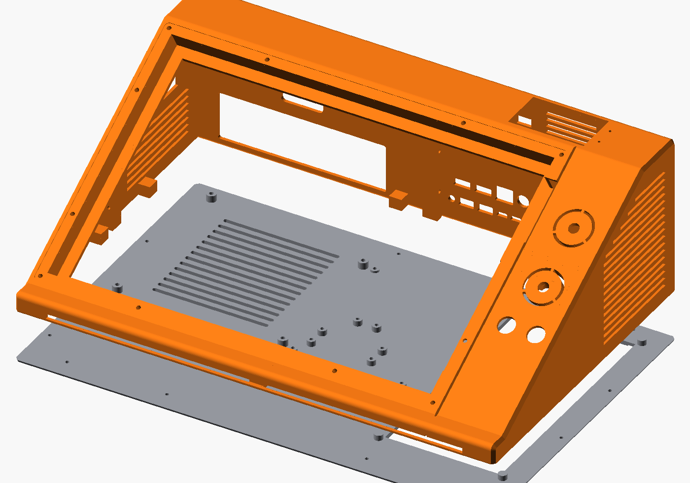

**NECESITAS:** Nada. Este paso no lleva tornillo.

Apoya la carcasa sobre la base. Cada orejeta cae sobre su agujero.

### 3.3 Tres orejetas de la pieza nueva

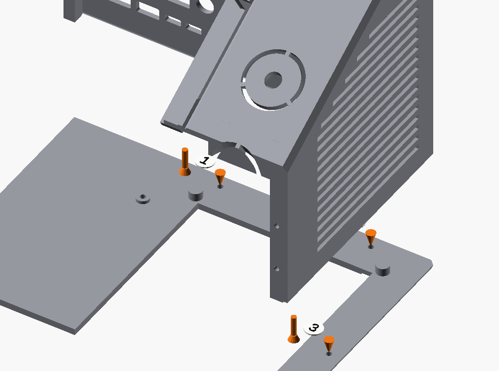

**NECESITAS:** 3× M3×8 avellanado negro, Phillips, wugongshan 860

Atornilla las tres orejetas de la carcasa de atrás a la derecha. Desde abajo, con M3×8 avellanado. Esa pieza se está imprimiendo: la guía es Ø2,5 × 9 mm y no lleva inserto. La cabeza entra en el avellanado del suelo. Entran unos 4 mm en la guía.

### 3.4 Cuatro orejetas del frente

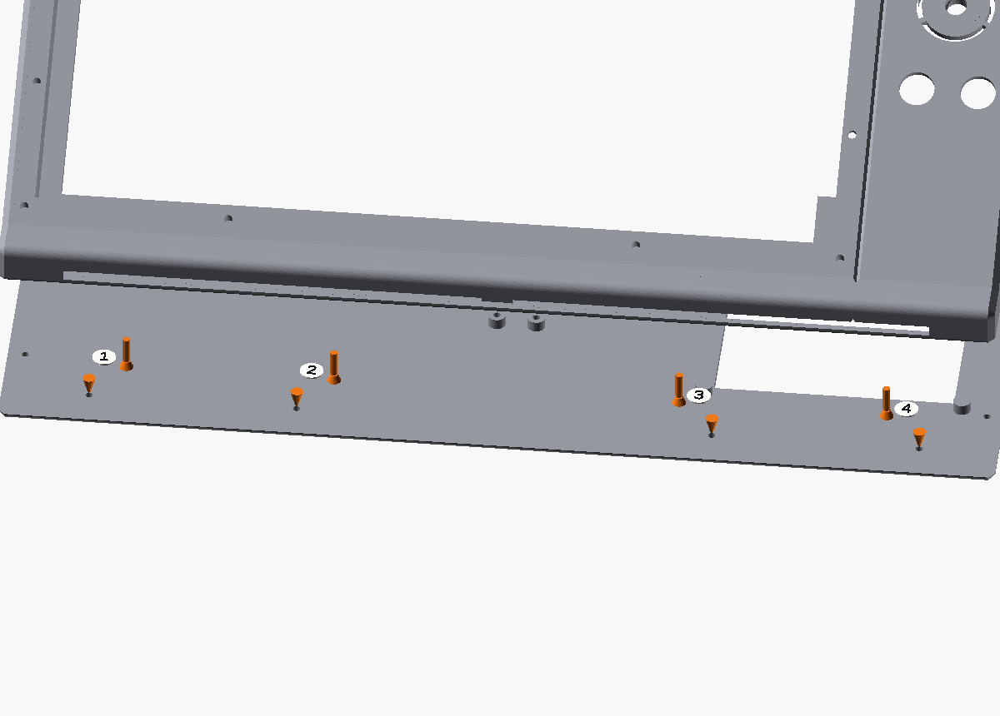

**NECESITAS:** 4× M3×8 avellanado negro, Phillips, wugongshan 860

Atornilla las cuatro del frente. Desde abajo, M3×8 avellanado, al inserto del 3.1.

### 3.5 Tres orejetas de la izquierda

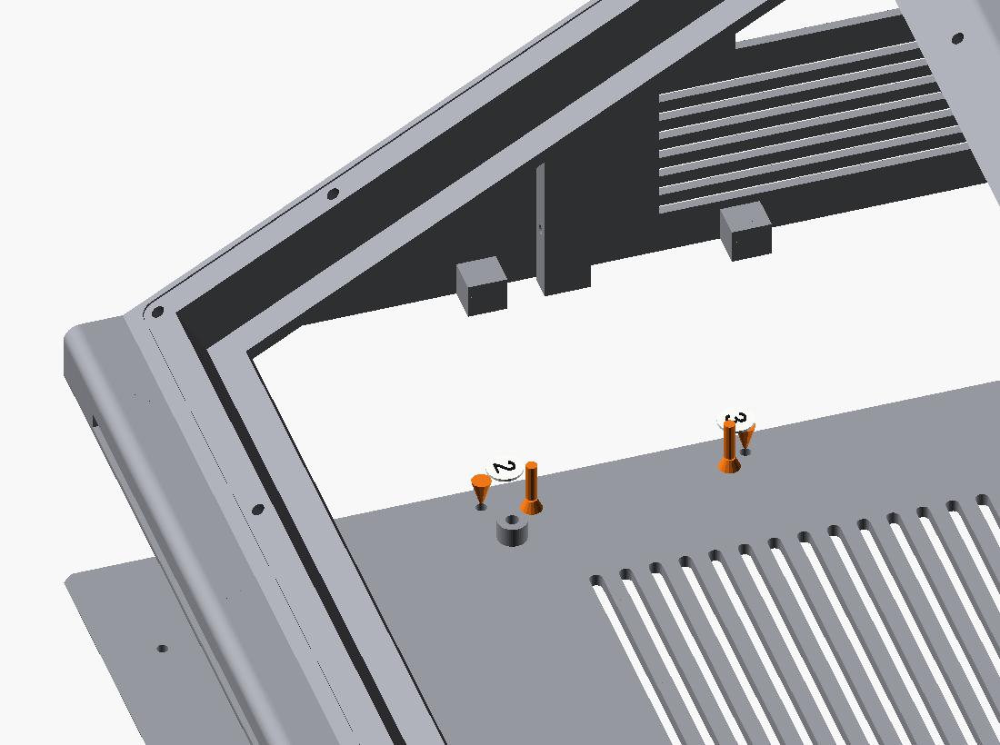

**NECESITAS:** 3× M3×8 avellanado negro, Phillips, wugongshan 860

Atornilla las tres del lateral izquierdo. Desde abajo, M3×8 avellanado.

### 3.6 Orejeta trasera que queda

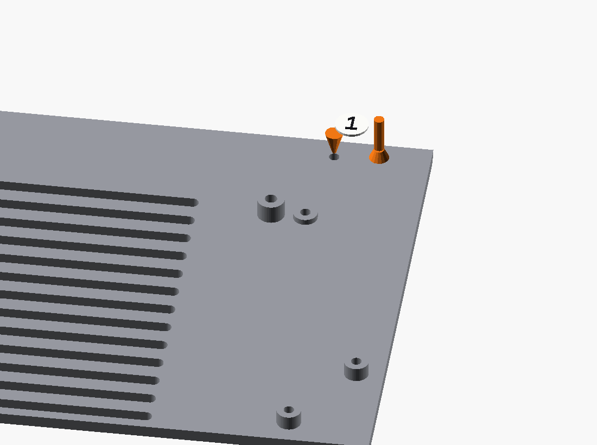

**NECESITAS:** 1× M3×8 avellanado negro, Phillips, wugongshan 860

Atornilla la orejeta trasera de la pieza izquierda. Desde abajo, M3×8 avellanado.

### 3.7 Dos orejetas de la derecha

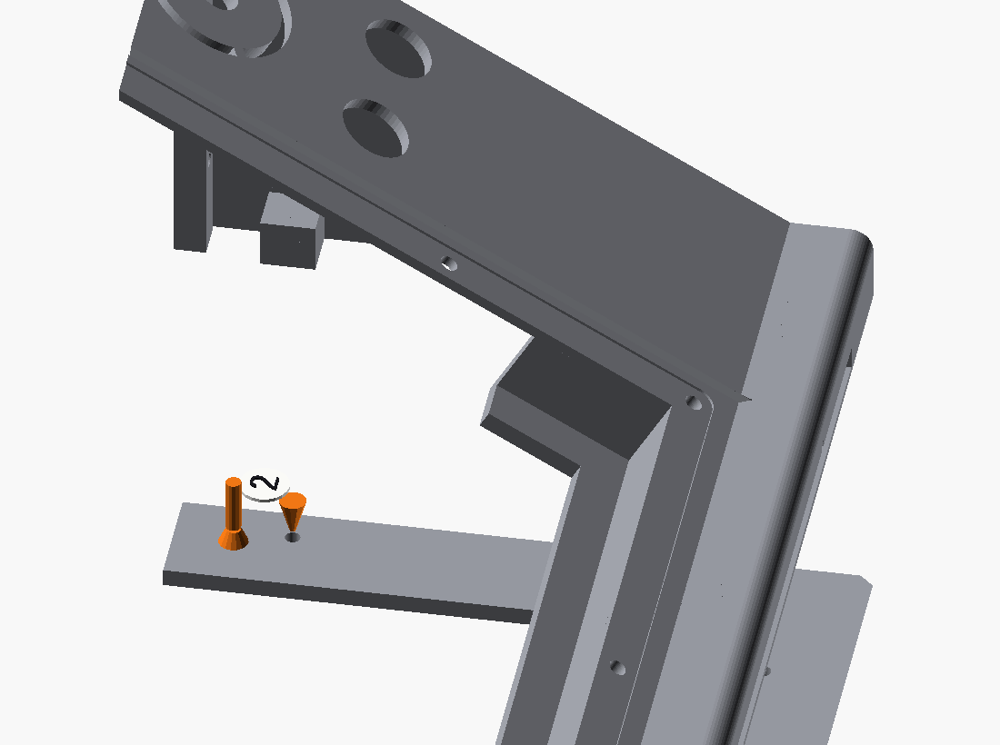

**NECESITAS:** 2× M3×8 avellanado negro, Phillips, wugongshan 860

Atornilla las dos del lateral derecho. Desde abajo, M3×8 avellanado.

De los kits, en este paso: 10× Inserto de latón M3, 5×5 mm (largo × Ø exterior), 13× M3×8 avellanado negro, Phillips, wugongshan 860.

## Paso 4. Disco y placa HP

La carcasa sigue puesta. En el dibujo no está, para que se vea el interior.

### 4.1 Cuatro insertos en el soporte del disco

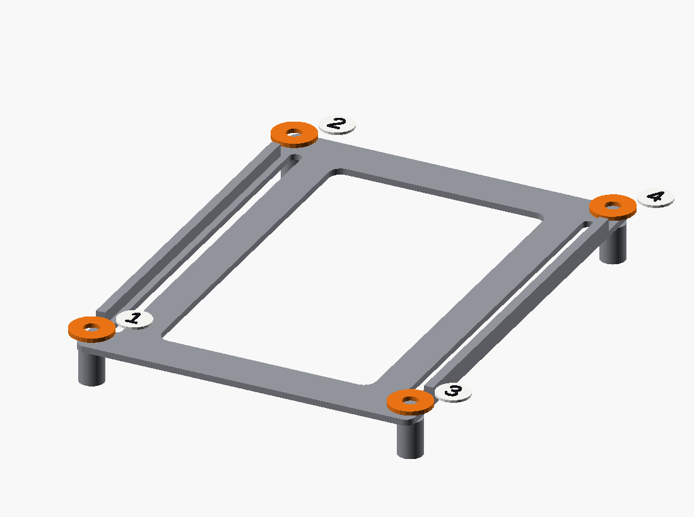

**NECESITAS:** 4× Inserto de latón M3, 5×5 mm (largo × Ø exterior)

Con el soldador, mete un inserto M3 de 5×5 en cada pata del soporte, desde arriba, a ras del plato. El agujero ya es Ø4 y mide unos 6,7 mm. No abras el Ø3,4 de la base.

**PENDIENTE DE MEDIR.** No consta si este soporte 3,5" ya está impreso. El STL no cambia: el agujero ya vale para el inserto. El Ø4,0 no se ha probado.

### 4.2 Soporte del disco

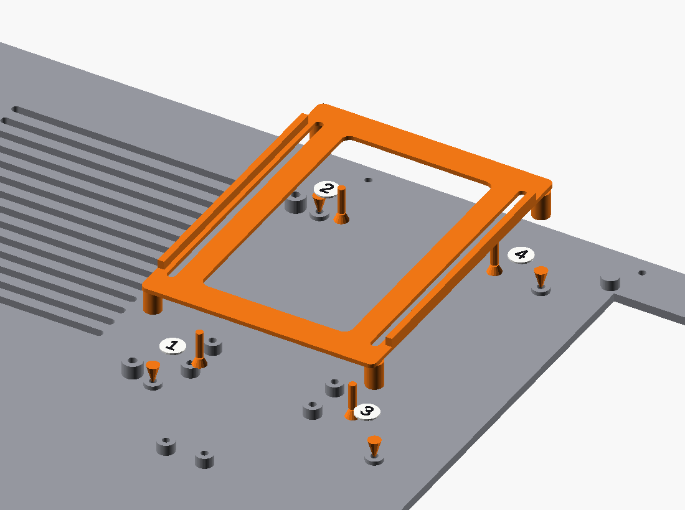

**NECESITAS:** 4× M3×8 avellanado negro, Phillips, wugongshan 860

Apoya el soporte en sus cuatro postes. Desde abajo, M3×8 avellanado. La cabeza entra en el avellanado de la base.

### 4.3 Disco Toshiba

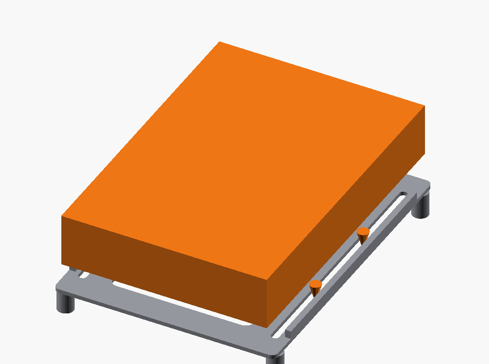

**NECESITAS:** 4× 6-32 UNC × 1/4" (6,4 mm), Phillips PH2. FALTA: comprar

Apoya el disco en el soporte, conectores hacia la ventana trasera. Los cuatro tornillos entran desde abajo, por el coliso, a la rosca del disco. Ningún kit trae 6-32.

**PENDIENTE DE MEDIR.** FALTA: comprar 4× 6-32 UNC × 1/4" (6,4 mm), Phillips PH2. Si aún tienes los tornillos originales de la torre HP, valen esos. Un inserto 1/4-20 no entra en esa rosca.

### 4.4 Cuatro insertos en los separadores HP

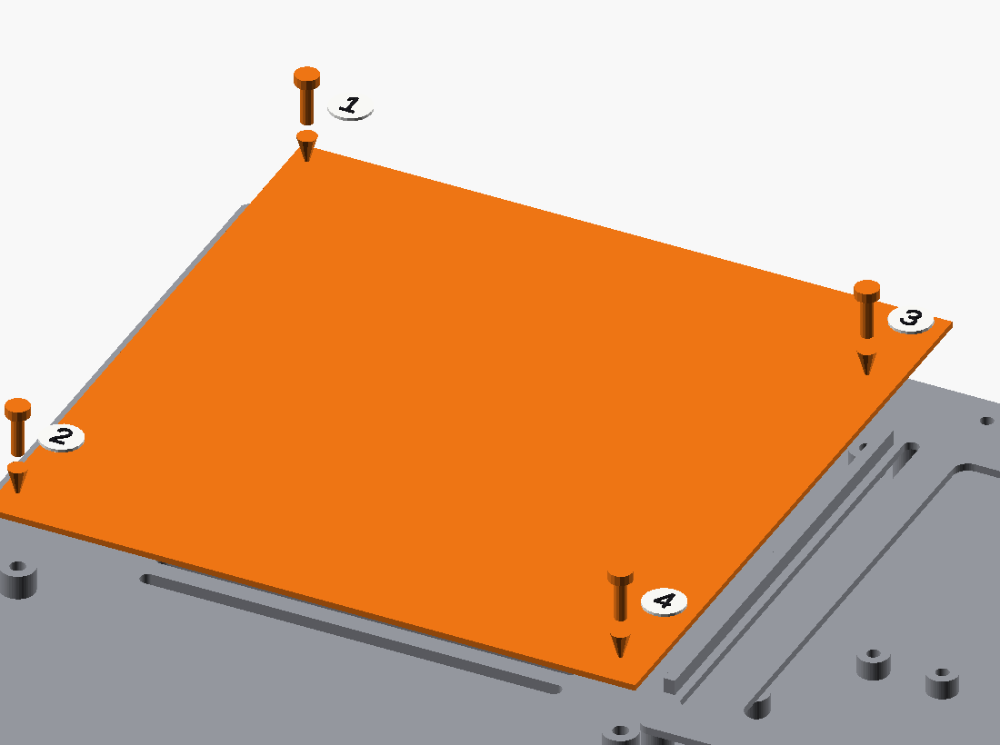

**NECESITAS:** 4× Inserto de latón M3, 4×5 mm

Con el soldador, mete un inserto M3 de 4×5 en cada separador, desde arriba, a ras. El agujero es Ø4 y mide unos 6,2 mm: el de 5×5 entra justo y el de 6×5 no. No atravieses el suelo.

**PENDIENTE DE MEDIR.** El Ø4,0 no se ha probado. La base ya está impresa: no se regenera.

### 4.5 Placa HP

**NECESITAS:** 4× M3×6 avellanado negro, Phillips, wugongshan 860

Apoya la placa en los cuatro separadores. Los conectores miran a la ventana trasera. Atornilla cuatro M3×6 avellanados. La cabeza queda sobre la PCB, en la esquina. Entran unos 2,6 mm en el inserto y no llegan al fondo.

**PENDIENTE DE MEDIR.** El dibujo no pone ningún componente sobre esos cuatro agujeros. Si la cabeza toca una pieza, para.

De los kits, en este paso: 4× Inserto de latón M3, 5×5 mm (largo × Ø exterior), 4× M3×8 avellanado negro, Phillips, wugongshan 860, 4× Inserto de latón M3, 4×5 mm, 4× M3×6 avellanado negro, Phillips, wugongshan 860. Fuera de los kits: 4× 6-32 UNC × 1/4" (6,4 mm), Phillips PH2. FALTA: comprar.

## Paso 5. Placa de conectores traseros

La ventana del HP ya está cortada: 159,75 × 45,45 mm. No la agrandes. Los huecos de la placa salen de la foto del 2026-10-23. Primero la prueba, por fuera.

### 5.0 Prueba el marco

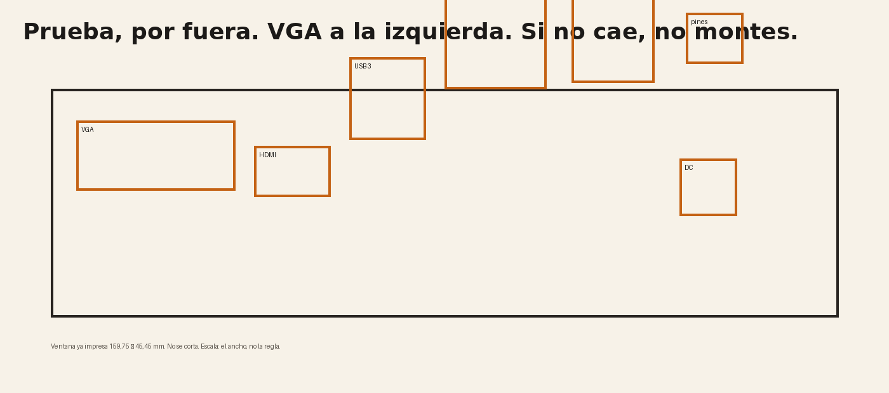

**NECESITAS:** 1× marco PRUEBA_placa_io_hp

Imprime la prueba plana, sin soportes. Apóyala por fuera de la ventana, con el mismo canto arriba. El hueco grande de la izquierda tiene que caer sobre el VGA azul. Si cae sobre otro conector, la placa está al revés: no la montes.

**PENDIENTE DE MEDIR.** La regla de la foto está delante y no se usa. La escala es el ancho ya impreso, 159,75 mm. Cada hueco lleva cerca de 1 mm de holgura. El error puede ser de 2 mm.

### 5.1 Mete la placa por dentro

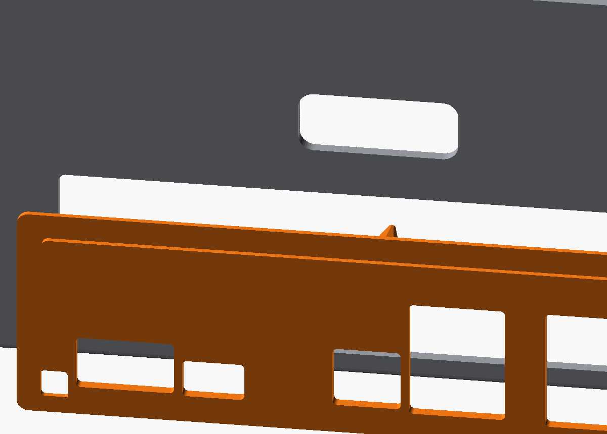

**NECESITAS:** 1× cianoacrilato

Cuando la prueba cuadre, imprime la placa con la pestaña abajo. Entra desde dentro. La pestaña queda hacia ti. Empuja hasta que el tetón asiente. No lleva tornillo: si se sale, pega el reborde a la cara interior. Mirando la trasera, de izquierda a derecha: VGA, HDMI, dos USB 3, RJ45 sobre dos USB 2, tres jacks, el jack DC arriba a la derecha y la cabecera suelta abajo a la derecha.

**PENDIENTE DE MEDIR.** Una lectura anterior ponía el DC a la izquierda. En esta foto el agujero redondo oscuro está a la derecha, junto a los pines. Si la prueba no coincide, para y no pegues.

Tornillos usados en este paso: ninguno.

## Paso 6. Frente izquierdo del HP

El Ø12,2, el Ø3,1 y la ventana de 62 × 18 ya están. No se cortan, no se taladran y no se agrandan. El marco entra a presión en esa ventana.

### 6.1 Prueba el capuchón

**NECESITAS:** 1× capuchón PROVISIONAL_boton_encendido  ·  1× placa PRUEBA_boton

Imprime la placa de prueba plana y el capuchón con la pestaña en la cama y el símbolo arriba. Sin soportes. Mete el vástago en el agujero grande. Tiene que entrar y salir solo. La pestaña no debe pasar. Si rasca, lija el vástago. No toques la carcasa.

**PENDIENTE DE MEDIR.** La holgura es 0,3 mm por lado: vástago Ø11,6 en agujero Ø12,2. Es de diseño. El agujero impreso puede haber quedado más estrecho.

### 6.2 Mete el capuchón

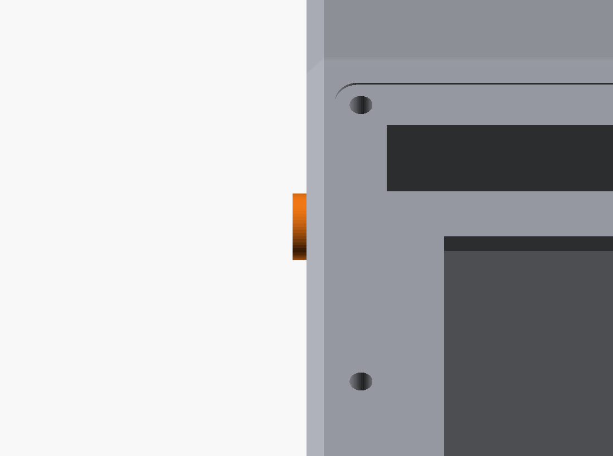

**NECESITAS:** 1× capuchón PROVISIONAL_boton_encendido

Desde dentro de la carcasa, mete el vástago en el Ø12,2. La pestaña se queda dentro y apoya en la pared. El símbolo queda fuera. Al pulsarlo recorre 1,5 mm y sigue asomando.

### 6.3 Pega el soporte

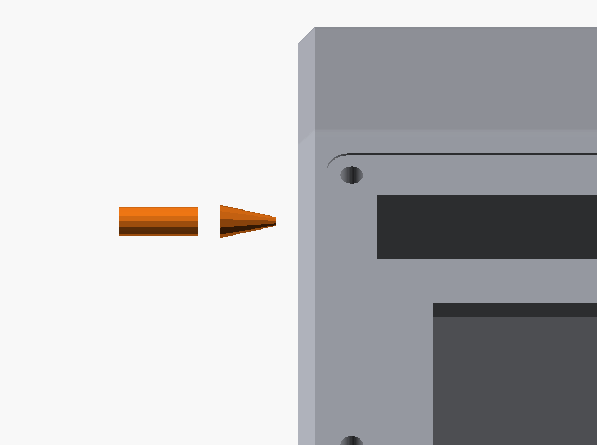

**NECESITAS:** 1× soporte PROVISIONAL_soporte_boton  ·  1× pulsador táctil 12×12×7,3 mm, 4 patillas, unos 100 gf  ·  1× LED de 3 mm, el color que quieras  ·  1× cianoacrilato

Imprime el soporte con el suelo en la cama. Sin soportes. La guía entra en el agujero pequeño, 14 mm por encima del pulsador. La cara plana apoya en la pared, por dentro. Pon cola en esa cara, alrededor de los dos agujeros, y aprieta un minuto. No pegues el capuchón. Mete el pulsador por arriba, vástago hacia el capuchón, hasta que pase los tetones. Mete el LED por arriba, cúpula hacia la guía y brida contra el escalón.

**PENDIENTE DE MEDIR.** El 12×12×7,3 y el reparto 5,0 mm de cuerpo más 2,3 mm de vástago son de catálogo, no un calibre. El capuchón vale también para un 6×6; el soporte, no: hay que reexportarlo.

### 6.4 Dos hilos al cabezal

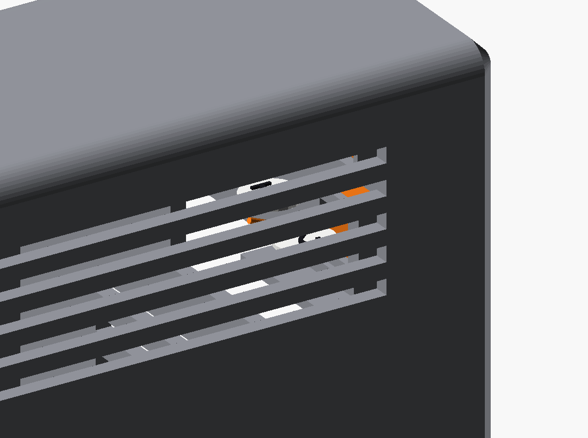

**NECESITAS:** 4× cable fino, 30 cm

Suelda dos hilos en el pulsador. Van en paralelo al botón original del HP, al cabezal del panel frontal. Mide antes con el polímetro qué patillas se unen al pulsar. Otros dos hilos, del LED al mismo cabezal. La resistencia de 1 kΩ solo si ese cabezal no trae ya una.

**PENDIENTE DE MEDIR.** El cabezal es H-6. El conector, las patillas y el largo del cable no están medidos. No hay mapa de pines.

### 6.5 Marco en la ventana, sin tocarla

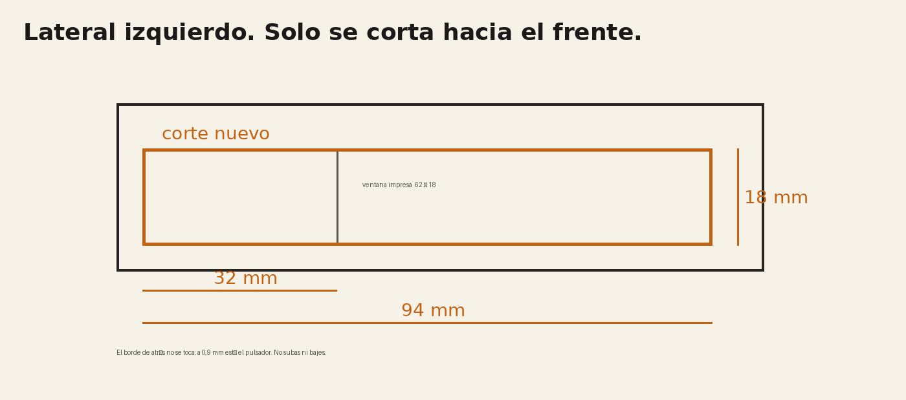

**NECESITAS:** Nada. Este paso no lleva tornillo.

Imprime el marco con la cara de fuera abajo y el faldón arriba, sin soportes. Esa cara queda fuera. Mételo en la ventana de 62 × 18 desde fuera, hasta que el reborde apoye en la pared. El reborde de atrás mide 0,4 mm y no tapa el Ø12,2. La boca queda de unos 60 × 16 mm. Desliza la chapa por dentro hasta que los dos USB y, si entra, el lector de tarjetas asomen por esa boca. Los dos jacks de audio del frontal se quedan detrás de la pared: el audio sigue en la placa trasera. Si el lector no asoma entero, se pierde también. No limes la ventana. Si un nervio del faldón aprieta, lija el nervio.

**PENDIENTE DE MEDIR.** La cara metálica mide unos 96 × 18 mm. En la foto, de un extremo al otro: dos jacks, dos USB y el lector. El jack más alto mide unos 13,5 mm y cabe en los 18. En 62 mm no caben los tres grupos. La boca del marco mide 59,8 × 15,8 mm: el lector va justo. Abajo, en el reborde, dice USB hacia el frente de la máquina y SD hacia el pulsador.

Tornillos usados en este paso: ninguno.

## Paso 7. Bandeja de placas

Bandeja v3. Imprímela: la que ya está hecha cierra los pines y no se corta. Los Dupont de las tres placas son hembra acodados a 90°. La grapa sustituye a la arandela: la lengüeta mira a la placa. La bandeja se atornilla a la base al final.

### 7.0 Cuatro insertos en la Pi

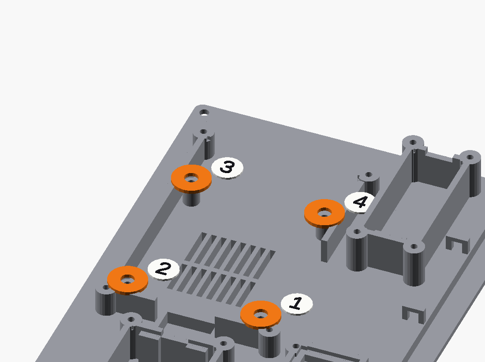

**NECESITAS:** 4× Inserto de latón M2.5, 4×3,5 mm

Con el soldador, mete un inserto M2.5 de 4×3,5 en cada poste de la Pi, desde arriba, a ras del poste. El agujero es Ø3,0 y mide 7 mm. No uses los cuatro postes de fuera: esos son el plan B.

**PENDIENTE DE MEDIR.** El Ø3,0 es el fallback para un inserto de Ø exterior 3,5. Sin ficha y sin probar. La v3 ya trae ese agujero, ciego, de 7 mm. No taladres la bandeja vieja: no se usa.

### 7.1 Raspberry Pi

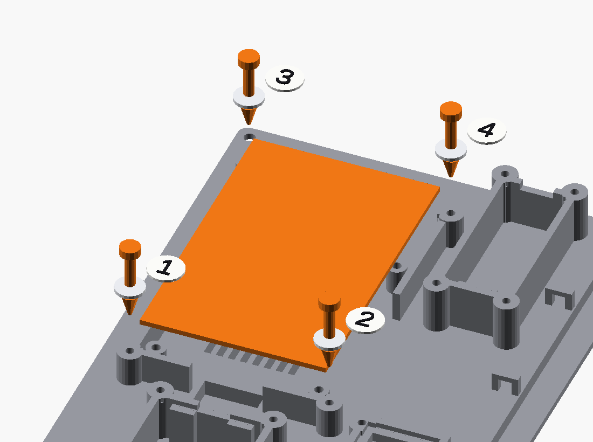

**NECESITAS:** 4× M2.5×8 cabeza de botón, Allen 1,5 mm, JINZEYOU 840

Pon la Pi en su hueco, con USB y RJ45 hacia atrás. Cuatro M2.5×8 de cabeza de botón, por los agujeros reales de la placa, al inserto. La PCB mide 1,6 mm: entran 6,4 mm, 4 en el inserto y 2,4 de punta.

### 7.2 Mira la ventana de los pines

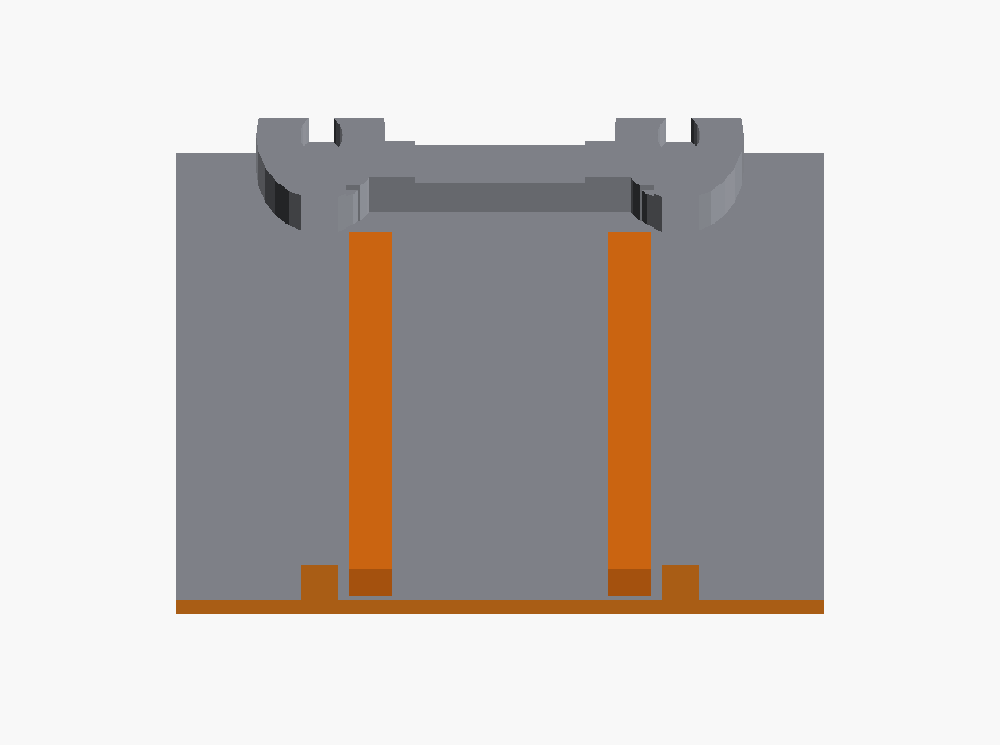

**NECESITAS:** Nada. Este paso no lleva tornillo.

El corte es el Nano de prácticas, a mitad del largo. Lo naranja son las dos filas. La pared larga no está: cada fila sale por una ventana de 40 mm de largo y 13 mm de alto, desde el suelo hasta la PCB. En cada extremo queda un retorno de 2,5 mm, donde no hay pin, y el poste. La placa apoya en el centro del canto corto.

**PENDIENTE DE MEDIR.** Un Dupont hembra recto mide unos 14,5 mm de carcasa. En 13 mm no entra: faltan 1,5 mm, y el hilo saldría contra el suelo. Hace falta la carcasa acodada a 90°, una por pin. El cable sale horizontal, sin curva forzada, y puede bajar a los puentes. Subir la PCB 7,5 mm para un recto chocaría con la tina en el ESP.

### 7.3 ESP8266

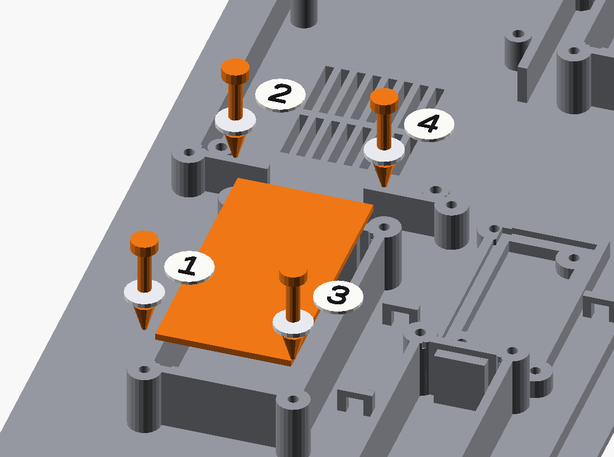

**NECESITAS:** 4× M3×12 cabeza de botón, Allen 2 mm, JINZEYOU 840  ·  4× grapa de esquina impresa, 1,6 mm

Pon el ESP en su hueco, pines hacia abajo y USB hacia atrás. Apoya en el centro de los dos cantos cortos: el del USB va partido, a cada lado del conector. Enchufa un Dupont hembra a 90° en cada pin. El cable del canto −X va hacia la Pi; el del canto +X, al corredor de los puentes (y = 100 y 132). Cuatro M3×12 de cabeza de botón. La grapa, de 1,6 mm, pisa la esquina. La guía es Ø2,5 y mide 13 mm. La ventana mide 53 × 13 mm.

**PENDIENTE DE MEDIR.** El hueco es 58×31 mm, sacado de una foto. Mide la PCB, cuántos pines tiene cada fila y el largo del pin. Si no entra, no la fuerces. No la subas: en la esquina delantera la PCB queda a 4,8 mm del suelo de la tina. La guía de la v3 ya mide 13 mm. No taladres la bandeja vieja.

### 7.4 Nano de prácticas

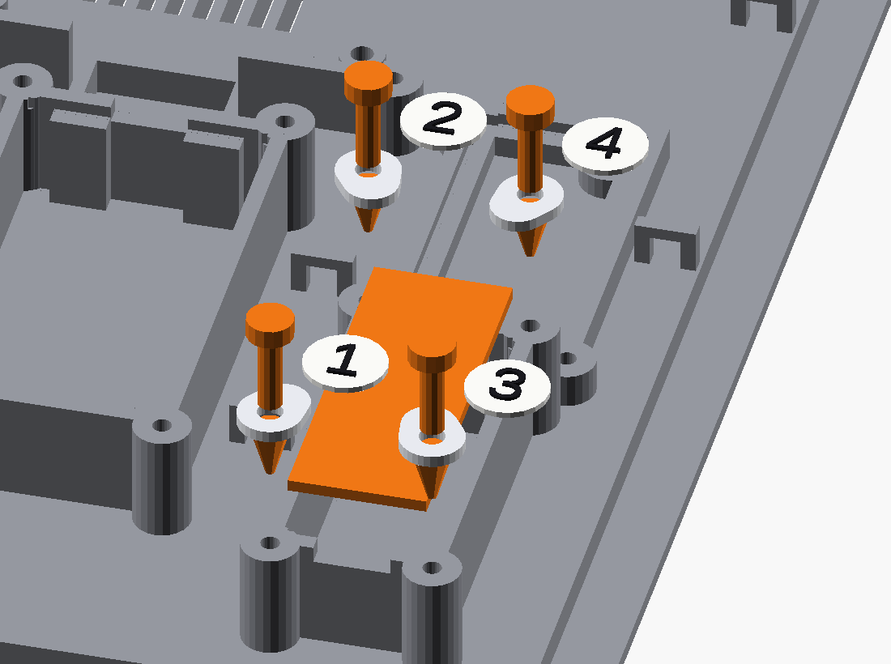

**NECESITAS:** 4× M3×12 cabeza de botón, Allen 2 mm, JINZEYOU 840  ·  4× grapa de esquina impresa, 1,6 mm

Pon el Nano de prácticas, pines hacia abajo y mini-USB hacia delante. Treinta Dupont hembra a 90°, uno por pin (2×15). El canto de atrás lleva el escalón central. En el canto del USB el conector ocupa el centro: sujetan las cuatro grapas. M3×12 de cabeza de botón, guía Ø2,5 de 13 mm. Cada ventana mide 40 × 13 mm.

**PENDIENTE DE MEDIR.** La huella de cada fila mide 3,2 mm desde el canto largo y empieza a 2,5 mm del canto corto. Es de diseño: el dibujo pone la fila a 15,24 mm y el primer pin a 2,4 mm. No es un calibre. La lengüeta entra unos 2,8 mm en esa esquina. La tapa de la Pi no llega a esta placa.

### 7.5 Hueco del step-down

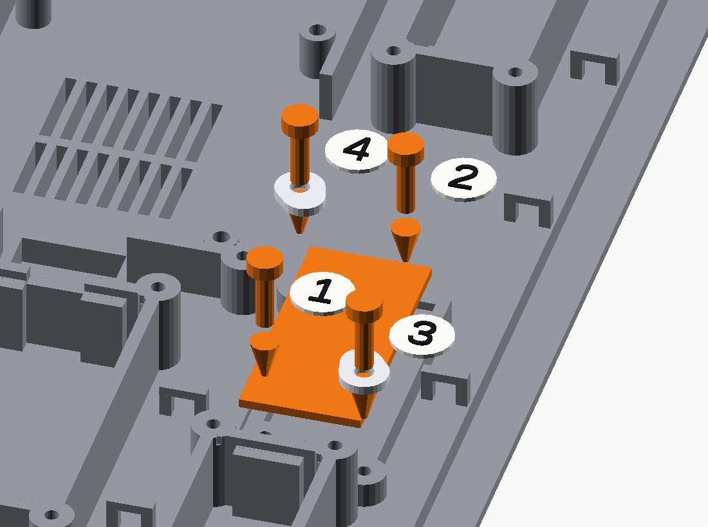

**NECESITAS:** 4× M3×8 cabeza de botón, Allen 2 mm, JINZEYOU 840  ·  2× grapa de esquina impresa, 1,6 mm

El hueco se queda para un LM2596 de 43 × 21 mm a 5 V. Aún no está: FALTA comprarlo. Lo que hay ahora en ese hueco es un convertidor de señal ZERO/SPAN de 4–20 mA, no un step-down. Si lo dejas ahí, los bornes van por encima de la PCB y el reborde, que acaba a ras, no los encierra. Los tornillos 1 y 2 atraviesan el módulo: M3×8 de cabeza de botón, sin grapa. Los 3 y 4 lo pisan con grapa, por fuera de la placa, el mismo M3×8. Debajo hay 3 mm para la soldadura.

**PENDIENTE DE MEDIR.** Agujeros a 3,5 mm de la esquina. En el modelo no hay regleta. Si el módulo lleva pines hacia abajo, para y mídelo. En el pasante entran 6,4 mm en una guía de 7 mm: quedan 0,6 mm hasta el fondo. No hay step-down en el inventario.

### 7.6 Nano de mandos

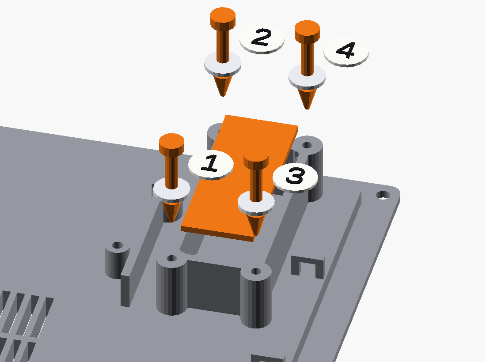

**NECESITAS:** 4× M3×12 cabeza de botón, Allen 2 mm, JINZEYOU 840  ·  4× grapa de esquina impresa, 1,6 mm

Pon el Nano de mandos, pines hacia abajo y mini-USB hacia atrás. Otros treinta Dupont hembra a 90°. Igual que el de prácticas: escalón en el canto contrario al USB, y en el del USB sujetan las grapas. M3×12 de cabeza de botón, guía Ø2,5 de 13 mm. Cada ventana mide 40 × 13 mm. El cable del canto +X pasa por los puentes de x = 423,5.

**PENDIENTE DE MEDIR.** Esta placa queda bajo el techo plano de x1_y1, con más de 100 mm de aire. El hueco de la tapa acaba en x = 396 y el Nano empieza en x = 400: el límite sigue siendo el techo.

### 7.7 Inserto en las cuatro torretas

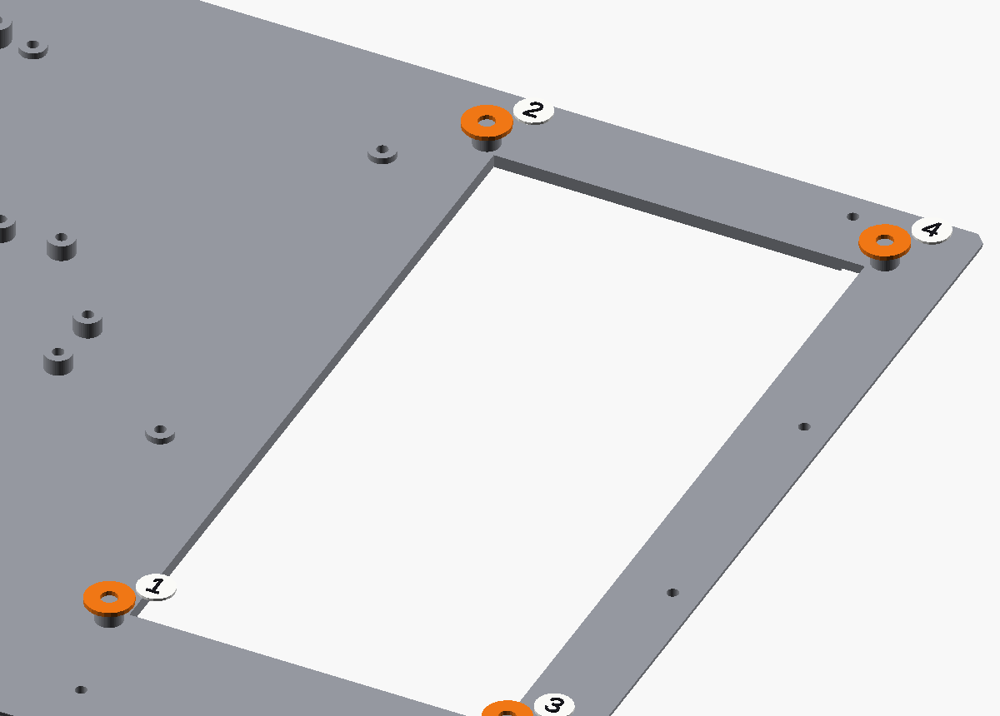

**NECESITAS:** 1× broca de Ø4,0 mm  ·  4× Inserto de latón M3, 6×5 mm

Con la broca de Ø4,0, abre el techo macizo de las cuatro torretas de la base hasta encontrar el agujero Ø4 que ya sube desde abajo. Con el soldador, mete un inserto M3 de 6×5 desde arriba, a ras de la torreta. No lo empujes hasta que asome por debajo.

**PENDIENTE DE MEDIR.** Si el techo ya se abrió a Ø3,4, ábrelo a Ø4,0. El kit trae 20 M3×16 y 17 ya están contados: estas cuatro torretas no pueden llevar otro M3×16.

### 7.8 Atornilla la bandeja

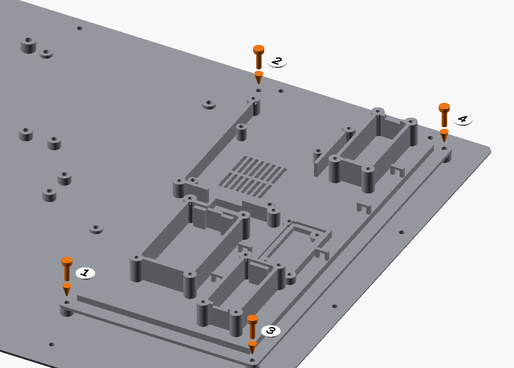

**NECESITAS:** 4× M3×8 cabeza de botón, Allen 2 mm, JINZEYOU 840

Apoya el ala en las cuatro torretas. M3×8 de cabeza de botón desde arriba, al inserto. Aprieta en cruz. La punta queda a ras del inserto, dentro de la base: no sale por debajo y no lleva tuerca.

De los kits, en este paso: 4× Inserto de latón M2.5, 4×3,5 mm, 4× M2.5×8 cabeza de botón, Allen 1,5 mm, JINZEYOU 840, 12× M3×12 cabeza de botón, Allen 2 mm, JINZEYOU 840, 8× M3×8 cabeza de botón, Allen 2 mm, JINZEYOU 840, 4× Inserto de latón M3, 6×5 mm.

## Paso 8. Tapa de la Pi

Dos tornillos. No hace falta ventilador. Imprime el STL de esta pasada: la tapa ya impresa sobresale del lomo y no se usa.

### 8.1 Cierra la tapa

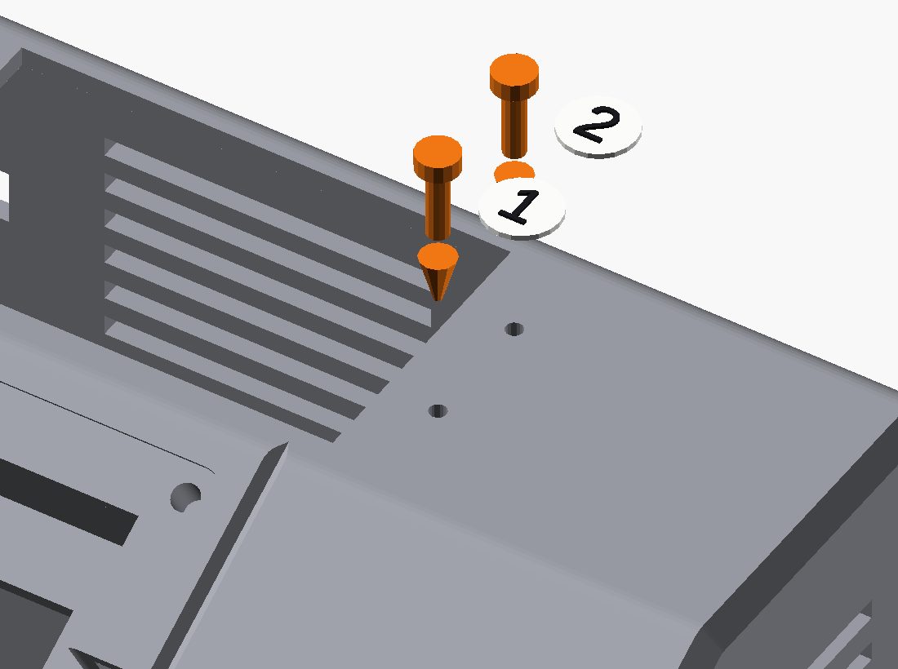

**NECESITAS:** 2× M3×8 cabeza de botón, Allen 2 mm, JINZEYOU 840

Imprime la tapa plana, con la cara del chaflán contra la cama y el tetón hacia arriba, sin soportes. Mide 92,00 × 46,79 × 4,60 mm. El tetón entra en el hueco de 72 × 42, con 0,3 mm de holgura por lado, y la placa se queda en el lomo plano: canto delantero en y = 248,5 y trasero en y = 295,3. Dos M3×8 de cabeza de botón en el canto derecho. En esos agujeros la placa mide 2,4 mm: el tornillo entra unos 5,6 mm en la guía de 9 mm. Los postes están en carcasa_x1_y1, ya impresa, y los agujeros Ø3,4 siguen en su sitio. La guía es Ø2,5. Se abre quitando esos dos tornillos. La carcasa no se reimprime.

De los kits, en este paso: 2× M3×8 cabeza de botón, Allen 2 mm, JINZEYOU 840.

## Paso 9. Trasera derecha: cables de la Pi y panel

carcasa_x1_y1 ya está impresa. No se corta ni se reimprime. Los agujeros viejos (audio, USB, HDMI, RJ45 y DC) no son la Pi: se tapan. Los pines salen por los Ø1,6 que ya hay.

### 9.1 Tapa los agujeros viejos

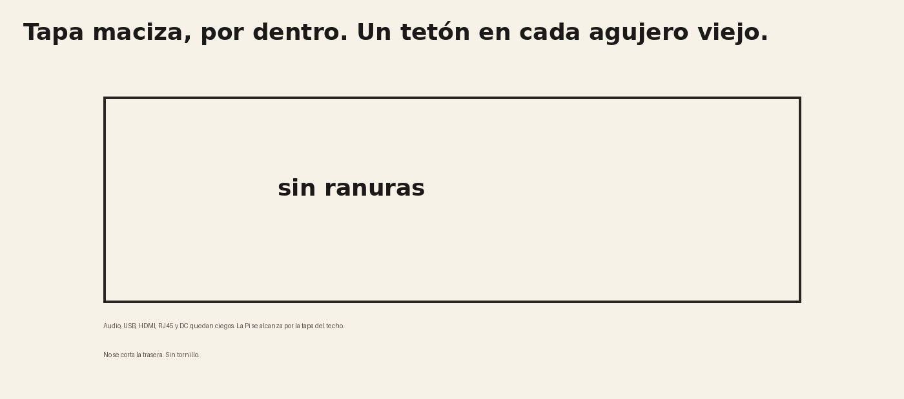

**NECESITAS:** Nada. Este paso no lleva tornillo.

Imprime la tapa con el reborde abajo y los tetones arriba, sin soportes. Entra desde dentro. Cada tetón cae en un agujero de los que ya hay: el círculo del audio, dos USB-A, dos USB-C, dos HDMI, el RJ45 y el círculo del DC. La cara de fuera queda lisa. Los cuatro USB y el RJ45 de la Pi no salen por aquí: la placa acaba 42 mm antes de la pared. Se alcanzan por la tapa del techo, la del paso 8. No abras ningún agujero.

**PENDIENTE DE MEDIR.** Si quisieras sacarlos por la trasera harían falta dos alargadores USB-A y uno RJ45. No están en el inventario: FALTA, y esta tapa no los usa. Si la tapa se cae hacia dentro, una gota de cola en el reborde. No en la carcasa con un corte.

### 9.2 Careta de pines, por fuera

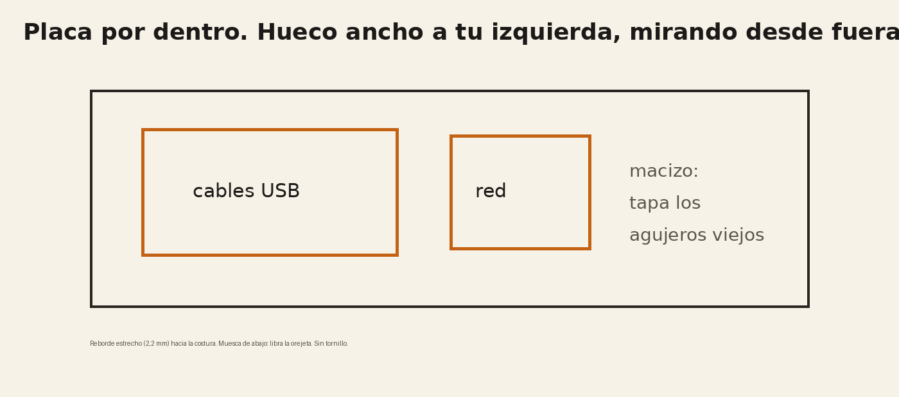

**NECESITAS:** 1× Regleta macho 2×20, paso 2,54 mm, pines de al menos 11 mm. FALTA: comprar  ·  1× Regleta macho 2×12, paso 2,54 mm, pines de al menos 11 mm. FALTA: comprar

Imprime la careta con la cara de los rótulos abajo y los ganchos arriba, sin soportes. Al montarla, esa cara queda fuera. Los cuatro ganchos entran en las ventanas que ya hay: dos en la OLED (24 × 14) y dos en PRG (14 × 8). Empuja hasta que el diente pase la pared. Si no pasa, lija el diente. No limes el grabado de la carcasa: la careta lo tapa. Desde dentro, mete la regleta macho de 2×20 en la fila de abajo y la de 2×12 en la de arriba. El plástico se queda dentro. Los pines atraviesan el Ø1,6 y la ranura, y asoman fuera. Ahí se enchufa un cable Dupont hembra. La ventana grande de arriba es la OLED. La pequeña, a tu izquierda mirando desde fuera, es PRG. De abajo arriba: PI, NO UNIR, NANO.

**PENDIENTE DE MEDIR.** FALTA: comprar las dos regletas macho, paso 2,54 mm, con pines de al menos 11 mm (3 mm de pared + 1,6 mm de careta + unos 6 mm fuera). Y cables Dupont hembra-hembra: el CSV de electrónica no se ha podido leer. Quedan fuera D0, D1 y cualquier pin de una regleta 2×15 que no tenga agujero: el Nano impreso es 2×12. No unas el 5 V del Nano con el 3,3 V de la Pi. Esta careta no lleva tornillo.

Fuera de los kits: 1× Regleta macho 2×20, paso 2,54 mm, pines de al menos 11 mm. FALTA: comprar, 1× Regleta macho 2×12, paso 2,54 mm, pines de al menos 11 mm. FALTA: comprar.

## Paso 10. Pantalla y mandos

El monitor entra en la tina. El bisel lo sujeta. Quitar esos tornillos lo suelta.

### 10.1 Mete el monitor

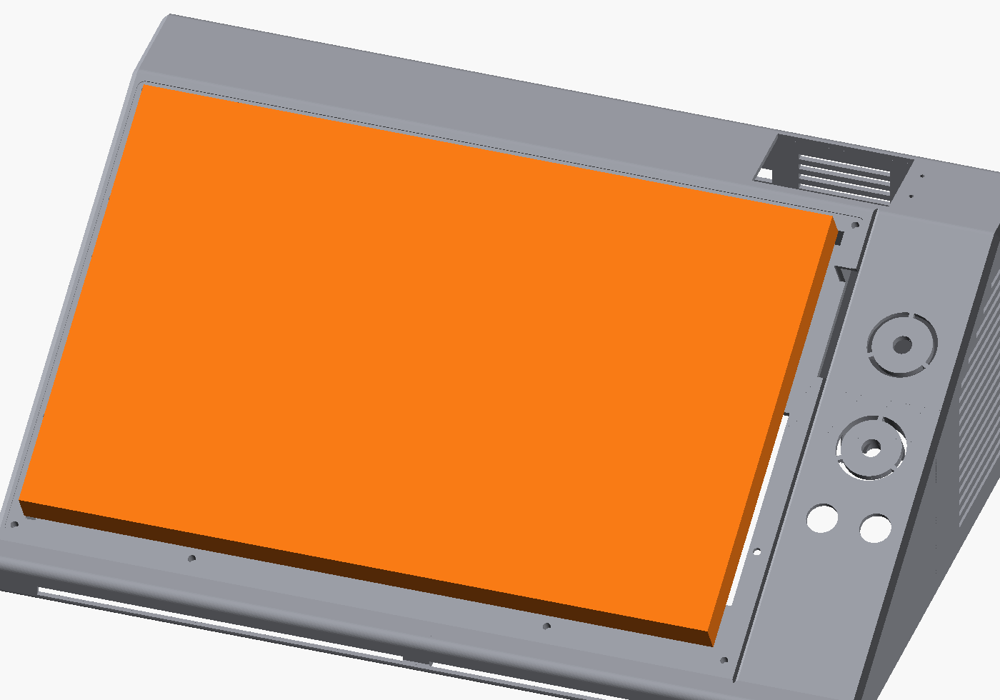

**NECESITAS:** Nada. Este paso no lleva tornillo.

Mete el monitor en la tina, con los conectores hacia la derecha.

### 10.2 Doce insertos en el marco

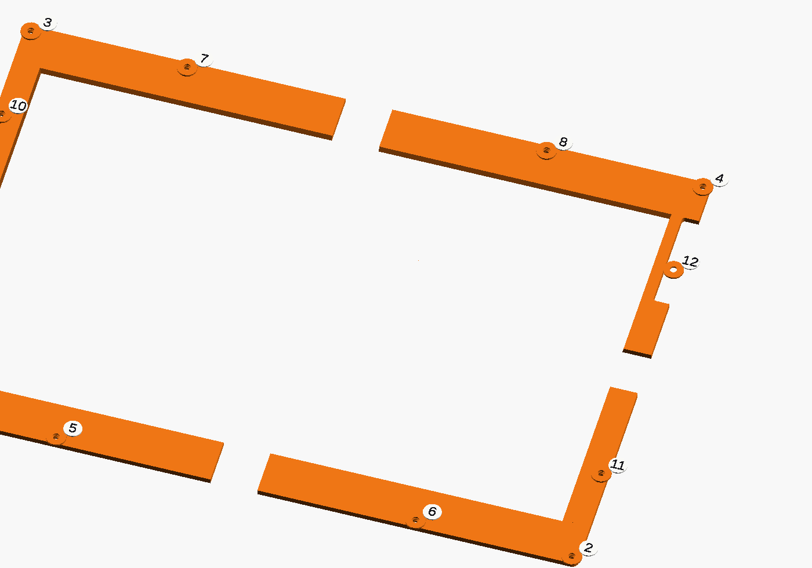

**NECESITAS:** 12× Inserto de latón M3, 5×5 mm (largo × Ø exterior)

Con el soldador, mete un inserto M3 de 5×5 en cada poste del marco, en la carcasa, desde fuera. El agujero ya es Ø4. No abras los biseles: ya tienen paso Ø3,4 y avellanado.

**PENDIENTE DE MEDIR.** No consta si los biseles ya están impresos. El STL del bisel no cambia. El Ø4,0 del inserto no se ha probado. La carcasa no se regenera.

### 10.3 Coloca los cuatro biseles

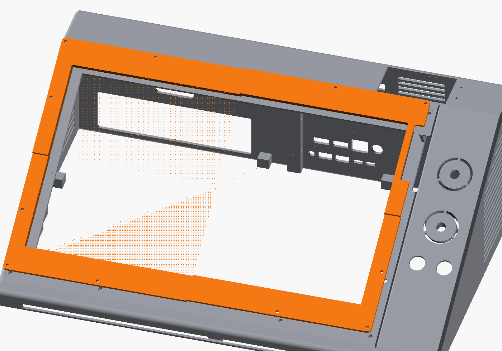

**NECESITAS:** Nada. Este paso no lleva tornillo.

Apoya los cuatro biseles sobre el marco. La muesca del canto derecho deja libres las teclas del monitor.

### 10.4 Atornilla el bisel

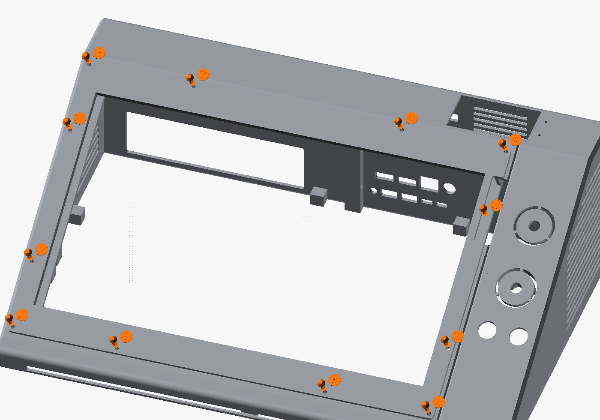

**NECESITAS:** 12× M3×8 avellanado negro, Phillips, wugongshan 860

Atornilla los doce desde fuera, con M3×8 avellanado. Ve saltando de un canto a otro. La cabeza entra en el avellanado del bisel.

### 10.5 Guías de luz

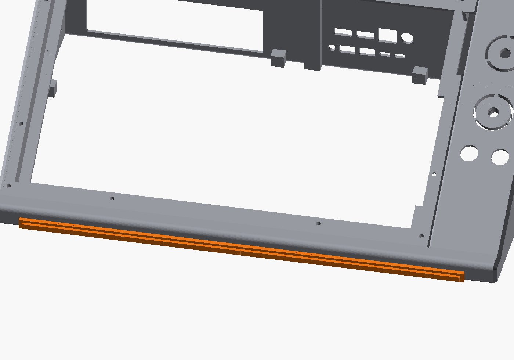

**NECESITAS:** Nada. Este paso no lleva tornillo.

Encaja las dos guías en el canal delantero. Sin tornillo.

### 10.6 Anillos

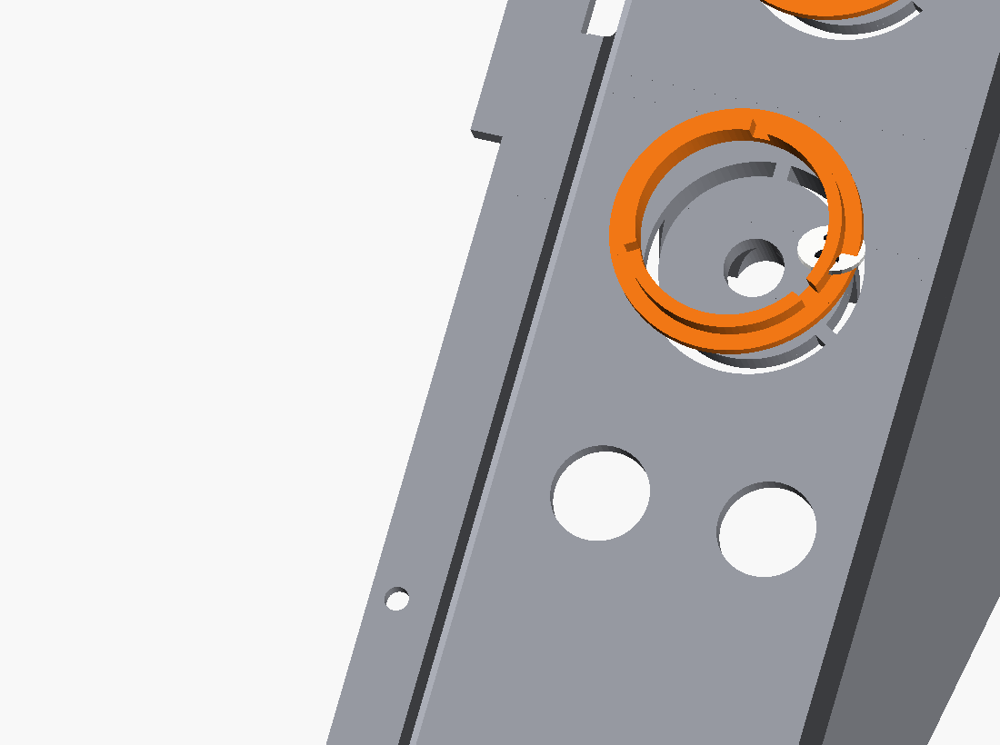

**NECESITAS:** Nada. Este paso no lleva tornillo.

Mete un anillo desde dentro, bajo cada sitio de pomo. Sin tornillo.

### 10.7a Inserto en cada pomo

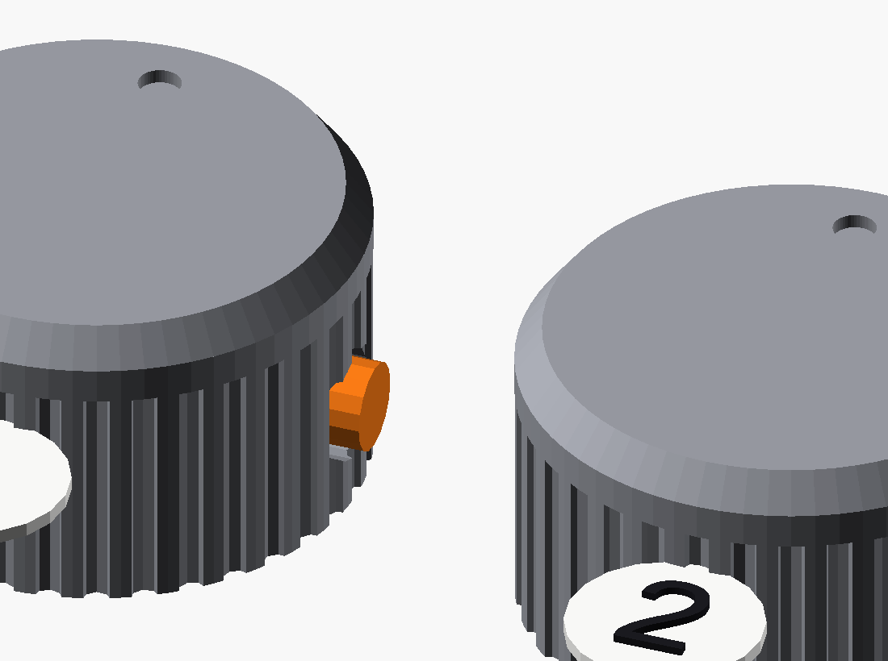

**NECESITAS:** 2× Inserto de latón M3, 4×5 mm

En el banco, con el soldador, mete un inserto M3 de 4×5 en el bolsillo radial de cada pomo. Queda a ras del agujero del eje, no dentro del eje. El bolsillo es Ø4,0.

**PENDIENTE DE MEDIR.** Si un pomo ya impreso solo tiene el agujero radial de Ø2,5, el inserto no entra: imprime el STL nuevo. De la piel al eje hay 12 mm y un avellanado M3×4 o ×5 no llega.

### 10.7 Pomos

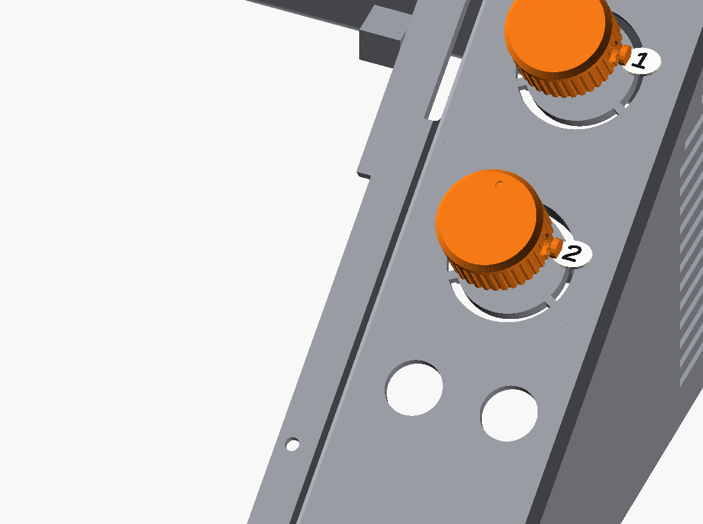

**NECESITAS:** 2× M3×12 cabeza de botón, Allen 2 mm, JINZEYOU 840

Encaja cada pomo. Mete un M3×12 de cabeza de botón en el cajeado y apriétalo contra el eje. La cabeza queda casi a ras. Si el eje no entra, para y mira el anexo.

### 10.8 Pulsadores del panel

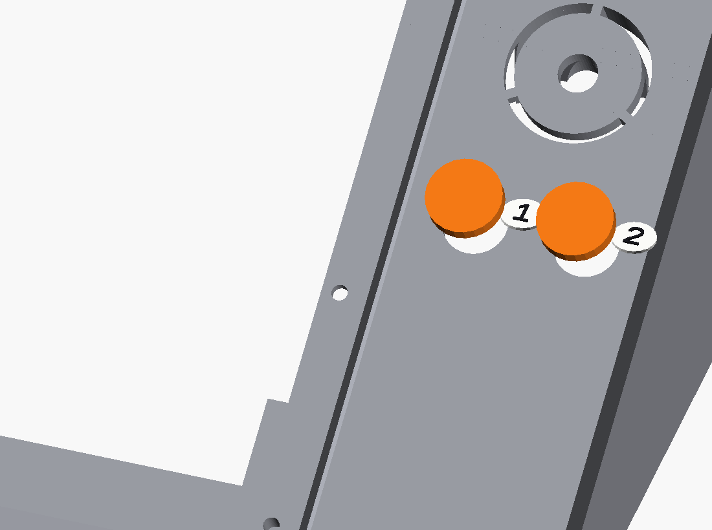

**NECESITAS:** Nada. Este paso no lleva tornillo.

Mete los dos pulsadores desde fuera y cierra su tuerca por dentro.

De los kits, en este paso: 12× Inserto de latón M3, 5×5 mm (largo × Ø exterior), 12× M3×8 avellanado negro, Phillips, wugongshan 860, 2× Inserto de latón M3, 4×5 mm, 2× M3×12 cabeza de botón, Allen 2 mm, JINZEYOU 840.

## Paso 11. Cables que ya están decididos

Lo gris del dibujo no se cablea. No hay red dentro de Orbit.

### 11.1 Jack del HP

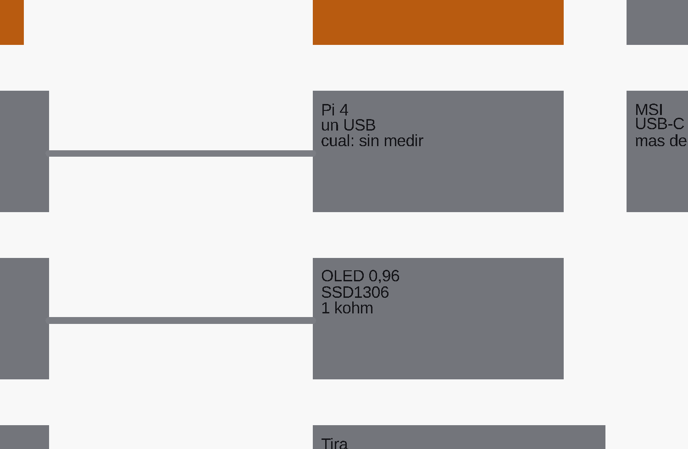

**NECESITAS:** Nada. Este paso no lleva tornillo.

Deja el adaptador de 19,5 V fuera. Enchufa solo su jack al conector trasero de la placa.

### 11.2 USB de mandos

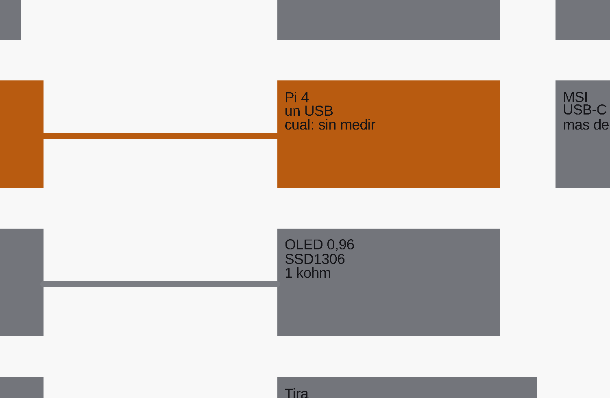

**NECESITAS:** Nada. Este paso no lleva tornillo.

Conecta el mini-USB del Nano de mandos a un USB de la Pi.

### 11.3 I2C del OLED

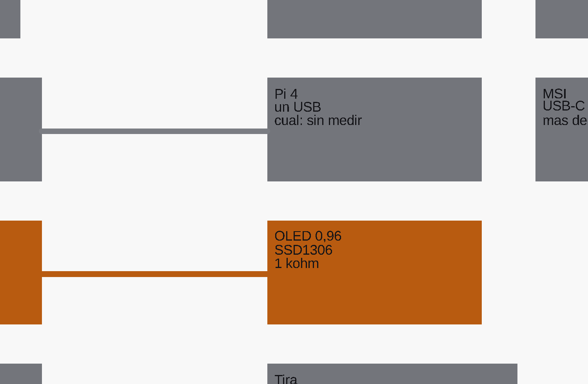

**NECESITAS:** Nada. Este paso no lleva tornillo.

Une SDA del OLED al A4 y SCL al A5 del Nano de prácticas. Una resistencia de 1 kΩ en cada señal.

### 11.4 Dato de la tira

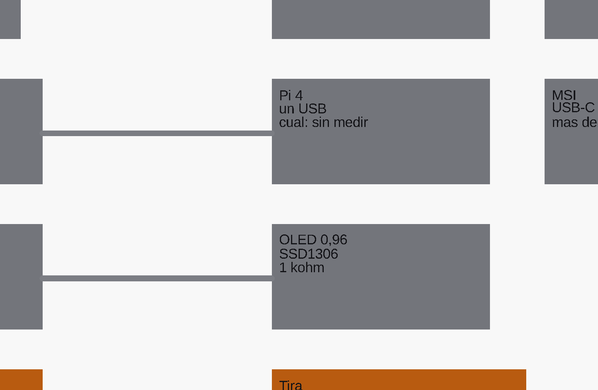

**NECESITAS:** Nada. Este paso no lleva tornillo.

Une el dato de la tira al GPIO2 del ESP. La masa de la tira, a la masa del ESP. No alimentes la tira desde el pin de 3,3 V.

### 11.5 Repasa

**NECESITAS:** Nada. Este paso no lleva tornillo.

Comprueba las cuatro uniones naranjas. No añadas los cables grises.

Tornillos usados en este paso: ninguno.

## Anexo

### Por qué este tornillo

El largo de una cabeza de botón se mide bajo la cabeza. El del avellanado incluye la cabeza. Nada de esto se ha apretado en una pieza impresa, salvo el M3 de los pasadores.

| Unión | Qué atraviesa | Tornillo |
|---|---|---|
| Pasador | Agujero Ø3,2 × 16 mm, las dos costillas | M3×16 botón. La cabeza se queda fuera. Ya gastados si la carcasa está cerrada. |
| Pletina | Pletina 3 mm + torreta 5 mm + suelo 4 mm = 12 mm | M3×16 botón. Salen unos 4 mm bajo la base, para la tuerca. |
| Bandeja a la base | Ala 2 mm + inserto de 6 mm en la torreta | M3×8 botón. La punta queda a ras del inserto, en z = 3, dentro del suelo. |
| Orejeta de x1_y1 | Suelo 4 mm + guía Ø2,5 de 9 mm | M3×8 avellanado. Entran unos 4 mm. No llega al fondo. |
| Orejeta ya impresa | Paso Ø3,4 del suelo e inserto 5×5 en la orejeta (agujero Ø4 × 5,7) | M3×8 avellanado. El inserto no va en el suelo. |
| Bisel | Bisel de 3 mm, con avellanado, e inserto 5×5 en el poste | M3×8 avellanado. |
| Soporte del disco | Paso Ø3,4 del suelo e inserto 5×5 en la pata | M3×8 avellanado. |
| Placa HP | PCB 1,6 mm + inserto 4×5 en un agujero de 6,2 mm | M3×6 avellanado. Entran unos 2,6 mm. La cabeza apoya en la PCB. |
| Marco frontal | Ventana impresa de 62 × 18. El faldón entra 2,2 mm, con 0,3 mm de holgura y cuatro nervios | Sin tornillo. Si aprieta, se lija el nervio del marco. |
| Disco | Rosca 6-32 del Toshiba, chapa de 2 mm | FALTA: 6-32 × 6,4 mm. No es un M3 ni un 1/4-20. |
| ESP y dos Nano | Grapa 1,6 mm + guía Ø2,5 de 13 mm | M3×12 botón. Entran 10,4 mm y quedan 2,6 mm hasta el fondo. |
| Pi | PCB 1,6 mm + inserto M2.5 de 4 mm en un agujero de 7 mm | M2.5×8 botón. Entran 6,4 mm. |
| Step-down, tornillo pasante | PCB 1,6 mm + guía de 7 mm | M3×8 botón. Quedan 0,6 mm hasta el fondo. |
| Step-down, brida | Grapa 1,6 mm + guía de 8 mm | M3×8 botón. |
| Tapa | Tapa 2,4 mm + guía de 9 mm | M3×8 botón. Entran unos 5,6 mm. |
| Pomo | De la piel al eje hay 12 mm. Cajeado 1,8 mm + inserto 4×5 | M3×12 botón. La punta entra unos 1,9 mm en el eje. |

### Por qué este agujero

El inserto de las diez orejetas viejas entra en el agujero que ya tienen, Ø4 × 5,7 mm. Un inserto de 6 mm no cabe. El suelo, de 4 mm, tampoco admite un inserto de 5 mm: el tornillo pasa por el Ø3,4 que ya está, y la cabeza avellanada se sienta en el avellanado que ya está. No se abre a Ø4,6.

Si ese Ø4 de la orejeta ya se agrandó a Ø4,6, el inserto no muerde. Ahí sí: M3 pasante y tuerca por arriba. En las columnas del frente no hay sitio para esa tuerca.

Las torretas de la bandeja tienen el techo macizo, de unos 3 mm, y debajo un Ø4 que ya sale por la cara inferior de la base. El 7.7 abre el techo a Ø4,0 y el inserto de 6×5 se queda a ras, sin asomar. No van con M3×16: 9 pasadores + 8 pletinas son 17, y el bote trae 20.

La Pi usa sus cuatro agujeros M2.5. Los postes de fuera se quedan en el STL, con guía de 13 mm, por si el inserto no agarra: entonces M3×12 y grapa, y esos cuatro no están en la cuenta.

La grapa mide 1,6 mm y la lengüeta llega a 6,2 mm del eje del tornillo. La esquina de la PCB está a unos 3,4 mm, así que la lengüeta entra unos 2,8 mm. Una arandela de Ø9 solo pisaba 1,1 mm y no está en los kits.

### Si algo no entra

La placa HP se mete por la abertura de la pantalla, con la carcasa ya puesta. Si no pasa, haz el paso 4 antes del paso 3.

Tres pletinas quedan debajo del soporte del disco: las dos del corte largo y la trasera del corte corto. Van en el paso 1, antes del disco.

El corte corto delantero de la carcasa no lleva tornillo. Los cinco del paso 2.3 están todos en la mitad de atrás. Los de los pasos 2.1 y 2.2 unen cada par de delante con atrás.

Si el eje del potenciómetro está estriado y el M3×12 no lo frena, hace falta un pomo comercial para eje estriado. El eje de 6 mm está acordado y sin medir. El plano en D sigue en el parámetro pomo_eje_D y no es la única retención.

### Coordenadas que usa el dibujo

No hacen falta para montar. Están por si hay que reimprimir una pieza.

- Envolvente: 456,26 × 300,49 × 153,92 mm. Cortes en x = 228,13 e y = 150,25.
- Pasadores de atrás, en el corte x: cinco, todos con y mayor que 150.
- Pasadores laterales: dos en x = 7 y dos en x = 449, a z = 25 y z = 55.
- Orejetas con guía Ø2,5, las de la carcasa nueva: (325; 292,5), (420; 292,5) y (448,3; 205).
- Las otras diez orejetas conservan el agujero Ø4 de cuando se imprimieron.
- Hueco de la Pi: origen (330; 167,5), 56 × 85 mm, USB hacia +Y. Los tornillos van en los agujeros reales. Postes de plan B en (328; 165,2), (388; 165,2), (327,8; 254,2) y (388,6; 254,2).
- ESP, de la foto: (346; 86), 31 × 58 mm. Nano de prácticas: (399; 66), 18 × 45. Step-down: (399; 124), 21 × 43. Nano de mandos: (400; 222), 18 × 45.
- Torretas de la bandeja: (318,3; 49), (436,3; 49), (318,3; 278,5) y (436,3; 278,5).

### Lo que sigue sin medir

Patillaje del cabezal H-6, conector y largo real del cable del botón. Si el pulsador no es el 12×12×7,3 de catálogo. Si el cabezal ya limita el LED. Cuánto mide de verdad cada boca de la chapa frontal (el marco deja 59,8 × 15,8 mm; el lector puede no asomar). Largo real de los pines macho de la bandeja (el canal usa 11,5 mm más 1,5 mm). Dónde acaba la fila respecto al canto (el canal usa 3,2 mm y deja 2,5 mm en el extremo). Cuántos pines tiene el ESP. El LM2596 aún no está: FALTA comprarlo, 43 × 21 mm a 5 V. ESP real. OLED real. HAT de la Pi. Tira de LED: tipo, ancho y tensión. Largo de los cables USB. Qué USB de la Pi usa el Nano de mandos. Eje del potenciómetro. Pies de goma. Diámetro del jack. Recorrido del step-down: no se ha dibujado ningún hilo.

### Pines bajo la PCB, bandeja v3

La bandeja ya impresa (`OBSOLETA_bandeja_huecos_v2_ya_impresa`, la de los huecos cerrados) no se reimprime y no se corta. No sirve: las cuatro paredes llegan hasta la PCB y el pin macho queda dentro. La v3 es `PROVISIONAL_bandeja_servicio`. Mismas posiciones, mismos 4 M3 a la base, misma Pi.

Nano de prácticas, Nano de mandos y ESP8266. La cara inferior de la PCB sigue a 13 mm del suelo. Ese 13 es 11,5 mm del pin más largo, separador incluido, más 1,5 mm de aire. [PENDIENTE] de medir. No se sube la placa.

Un Dupont hembra recto no cabe. La carcasa mide unos 14,5 mm a lo largo del pin y el hueco mide 13: faltan 1,5 mm para apoyar, y el hilo saldría contra el suelo, sin radio de curva. Para un recto con unos 6 mm de curva harían falta 20,5 mm bajo la PCB, o sea subirla 7,5 mm. El ESP no puede: en la esquina delantera (y = 86, canto +X, bajo el reborde de la tina) la PCB queda a 4,8 mm del plástico. Un elevador sobre los postes tampoco abre las paredes que ya están impresas, y un M3×12 solo deja 2,6 mm de más en la guía de 13 mm. Por eso no hay pieza elevadora. Hace falta un Dupont hembra acodado a 90° en cada pin (FALTA: comprar). La carcasa a 90° ocupa unos 2,5 mm a lo largo del pin y el cable sale horizontal por la ventana.

Cada fila tiene una ventana en el canto largo, desde el suelo hasta la cara superior de la PCB. El claro es 13 mm de alto. En Y mide 40 mm en los dos Nano (largo 45 menos 2,5 mm por extremo) y 53 mm en el ESP (largo 58). El retorno de la esquina y el poste no tapan pines. El apoyo sigue siendo un escalón de 2 mm en la banda central del canto corto. En el canto del mini-USB de los dos Nano el conector ocupa el centro y el escalón no llega a 1,6 mm: no se imprime, y sujetan las cuatro grapas. El ESP, más ancho, sí lleva escalón a los dos lados del USB.

El cable puede bajar al suelo y pasar bajo los siete puentes que ya había (barra a 4,2 mm del suelo, luz de unos 4 mm). El hilo de un Dupont, de cerca de 1,2 mm, entra. Hacia la Pi sale el canto −X del ESP. Hacia el panel de pines y la OLED, el corredor de la derecha y los puentes de x = 423,5.

La guía de la esquina es Ø2,5 × 13 mm. El poste mide 14,8 mm: arranca 0,2 mm bajo el suelo y llega a la cara superior de la PCB (suelo 4 + 13 + PCB 1,6). Con la grapa de 1,6 mm, el M3×12 entra 10,4 mm y le quedan 2,6 mm hasta el fondo. El eje está a 1,5 mm del canto largo y a 3,0 mm del canto corto. La v3 ya trae esa guía. No se alarga a broca.

Con la bandeja en sus torretas, el ala queda a z = 11 y la cara inferior de estas tres PCB a z = 28. La carcasa y la tapa no se han tocado.

El Nano de prácticas cae bajo la pendiente de la carcasa delantera derecha. En y = 66, un USB o un chip de 4 mm sobre la PCB queda a 12,6 mm del techo interior. El ICSP del dibujo, 8 mm y en el extremo contrario al USB, queda a unos 35 mm. La tapa de la Pi no llega a esta placa.

El ESP queda debajo de la tina de la pantalla. En el borde delantero, la PCB (1,6 mm) tiene 4,8 mm hasta el suelo de esa tina. El módulo del dibujo, 3 mm y centrado, queda a 14 mm. El USB mira atrás, donde la tina está más alta. Un componente de 4 mm pegado al borde delantero quedaría a 0,8 mm: el dibujo no pone ninguno ahí.

El Nano de mandos queda bajo el techo plano de la carcasa x1_y1. Hasta ese techo interior hay 117 mm. El hueco de la tapa acaba en x = 396 y la placa empieza en x = 400. La tapa apoya sobre el techo macizo, así que el límite es el techo.

La Pi sigue a 8 mm del suelo, con su rejilla, y se atornilla por sus agujeros M2.5. Los cuatro tornillos de la bandeja a la base son M3×8 de botón sobre un inserto de 6×5. El hueco de 43 × 21 mm sigue con 3 mm bajo la PCB para la soldadura y el reborde a ras: no encierra un borne de arriba. No hay step-down en el inventario. FALTA: comprar un LM2596 de 43 × 21 mm a 5 V. Lo que está en ese hueco es un convertidor ZERO/SPAN de 4–20 mA.

### Botón de encendido

La carcasa x0_y1 ya está impresa y no se regenera. El capuchón usa el Ø12,2 (eje a z = 112) y la guía el Ø3,1, 14 mm más arriba, en el lateral izquierdo. Holgura del vástago: 0,3 mm por lado. La pestaña es Ø16 × 1,6 mm y no sale. En reposo asoma 2,4 mm. El recorrido es 1,5 mm, hasta un tope; el clic del táctil, de 0,25 mm, ocurre al final. Dos láminas de 0,8 mm lo devuelven. Esa fuerza no se ha medido.

El soporte se pega con cianoacrilato a la cara interior. No hay un poste donde enroscar. Si la cola no aguanta, el plan B son dos taladros desde dentro: broca de Ø1,6 mm, profundidad 2,0 mm, sin atravesar la pared de 3 mm. Van a 14 mm a cada lado del eje del pulsador y a su misma altura. El tornillo es un M2×3 de cabeza plana (wugongshan, plata): pasa por el Ø2,7 del soporte y muerde la pared. Esos dos no están en la cuenta. El bote trae 50. No uses un M3.

El soporte queda por encima del marco del I/O frontal. El reborde del marco llega a z = 96 y el soporte empieza en z = 101,4. No lo uses de anclaje del marco.

Los huecos de la placa I/O salen de la foto del 2026-10-23, escalada al ancho ya impreso de 159,75 mm. No es un calibre: puede fallar 2 mm. Mirando la trasera, el VGA queda a la izquierda y el jack DC a la derecha. La prueba se apoya por fuera antes de montar la placa. Esa ventana no se agranda. Quedan a mano el VGA, el HDMI, los dos USB 3, el RJ45 sobre los dos USB 2, los tres jacks, el jack DC y los pines sueltos.

### Carcasa futura, no imprimir ahora

`FUTURO_carcasa_x0_y1_sin_adaptadores` y `FUTURO_carcasa_x1_y1_sin_adaptadores` son la misma carcasa con los huecos ya en su sitio, para no necesitar marco, tapa ni careta. No se imprimen ahora. Si algún día se imprimen, son piezas de noche. La frontal abre 94 × 18 mm (y = 171,5 a 265,5, z = 74 a 92) y caben los jacks, los dos USB y el lector. La trasera derecha cambia el panel genérico por dos pasos de cable (RJ45 y USB, alineados con la Pi) y cambia los Ø1,6 por dos ranuras de regleta: Pi 2×20 y Nano 2×15. El botón, el LED y la ventana del HP trasero siguen igual.

### Cableado fino

Nano de mandos: P1 en A0, P2 en A1, con los extremos a 5 V y a masa. B1 en D2 y B2 en D3, a masa, con la resistencia interna. D0 y D1 son el serial. D6 se queda libre. 115200 baudios. El puerto de ejemplo es /dev/ttyUSB0. Abrir el puerto reinicia la placa; orbitd espera 2,0 s antes de escribir «?». Ese tiempo es de diseño. No hay HID.

OLED: SSD1306 en 0x3C. SDA en A4, SCL en A5. 5 V solo si el módulo lo admite. 1 kΩ en las señales que salen al panel, no en 5 V, 3,3 V ni masa. La careta tapa el grabado viejo y dice PI, NO UNIR y NANO. No se unen 5 V con 3,3 V. La regleta macho 2×20 es la de la Pi; la 2×12, la del Nano. El cabezal de la propia Pi sigue ocupado si hay HAT: no lo cablees hasta medir el HAT.

Tira: el dato sale de GPIO2, que es D4. GPIO2 tiene que estar alto al arrancar. La masa de la tira va con la del ESP. La alimentación de la tira no sale del regulador de 3,3 V del módulo. Tensión y tipo, sin medir.

La Pi y el monitor llevan su propia fuente USB-C. El monitor pide más de 15 W. El adaptador del HP, 65 W a 19,5 V, se queda fuera.

